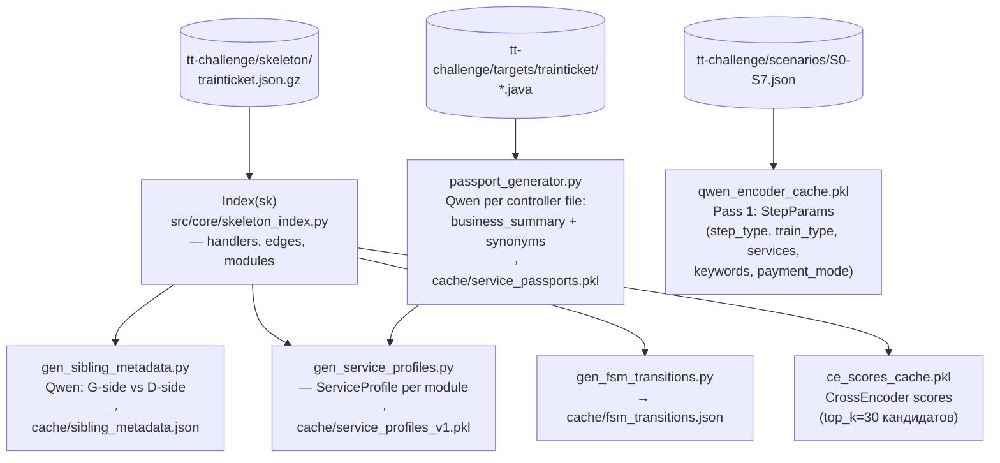
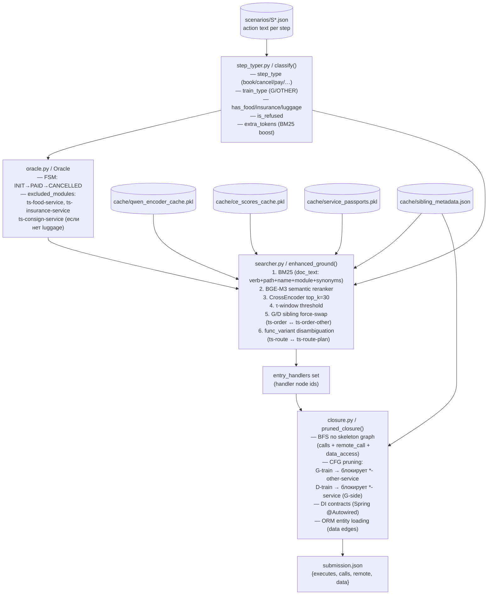

# TechArena — Execution Trace Predictor

Предиктор execution trace для микросервисного проекта [Train Ticket](tt-challenge/README.md).  
По текстовому описанию сценария (S0–S7) предсказывает граф вызовов: какие методы выполнились, какие вызовы между сервисами произошли, к каким таблицам обратился код.

**Текущий best на платформе: 0.803661** (avg IoU по S1–S7)

---

## Архитектура

Система работает в два режима: **offline** (генерация кешей) и **online** (predict pipeline).

### Offline: подготовка данных



### Online: predict pipeline



---

## Структура проекта

```
src/
├── predict.py              # точка входа online pipeline
├── domain_config.yaml      # step_rules, step_train_patterns, tier4_executes_tokens
├── localization/
│   ├── step_typer.py       # классификация шага → StepInfo + extra_tokens
│   ├── searcher.py         # enhanced_ground(): BM25 + BGE-M3 + CE + sibling swap
│   ├── qwen_encoder.py     # Qwen Pass 1: StepParams (9 полей)
│   ├── passport_generator.py  # Qwen: business_summary + synonyms per controller method
│   └── hub_scorer.py       # топологический boost (hub → downstream)
├── trace/
│   ├── closure.py          # pruned_closure(): BFS + CFG + DI + ORM
│   └── oracle.py           # Oracle FSM + excluded_modules
└── core/
    ├── skeleton_index.py   # Index: граф + handlers + modules
    └── bm25.py             # BM25 реализация

scripts/
├── pack.py                 # генерирует submission + пакует zip для платформы
├── submit.py               # отправляет zip на olympic.nsu.ru + polling
├── eval.py                 # локальная оценка по S0 gold
├── gen_sibling_metadata.py # offline: G/D пары сервисов → sibling_metadata.json
├── gen_service_profiles.py # offline: ServiceProfile + паспорта → service_profiles_v1.pkl
├── gen_fsm_transitions.py  # offline: FSM переходы → fsm_transitions.json
└── diff_predictions.py     # сравнение двух submission.json

tt-challenge/
├── skeleton/trainticket.json.gz  # граф-скелет (nodes + edges)
├── targets/trainticket/          # исходники Java (41 микросервис)
├── scenarios/S0-S7.json          # описания сценариев
├── gold/S0.json                  # правильный ответ для S0
└── context/                      # начальное состояние БД

cache/
├── service_passports.pkl   # {filename:hash → {method: {business_summary, synonyms}}}
├── qwen_encoder_cache.pkl  # {("cls_v2", action) → StepParams}
├── ce_scores_cache.pkl     # {(query, candidate) → float}
├── sibling_metadata.json   # {service → {variant_type, is_g_side, sibling}}
├── service_profiles_v1.pkl # {service → ServiceProfile}
└── fsm_transitions.json    # FSM переходы между step_type
```

---

## Примеры вызовов

### Базовый predict

```bash
# Один сценарий
python src/predict.py tt-challenge/scenarios/S0.json -o submission.json

# Все сценарии S0-S7
python src/predict.py tt-challenge/scenarios/S{0..7}.json -o submission.json
```

### Локальная оценка

```bash
# IoU по S0 (gold доступен)
python scripts/eval.py submission.json

# Сравнить два submission
python scripts/eval.py submission.json --vs scripts/_submission.json

# Запустить predict + оценить сразу
python scripts/eval.py --run

# С подробным diff
python scripts/eval.py --run --vs sample/submission.json
```

### Pack + submit

```bash
# Сгенерировать submission.json + упаковать zip
python scripts/pack.py

# Только упаковать (submission.json уже есть)
python scripts/pack.py --no-regen

# Отправить последний zip на платформу
python scripts/submit.py

# Отправить конкретный файл
python scripts/submit.py submission_20261021_103819.zip

# Только посмотреть последние результаты
python scripts/submit.py --scores
```

### Offline: обновить кеши

```bash
# G/D sibling пары (Qwen classification)
python scripts/gen_sibling_metadata.py

# Паспорта методов + профили сервисов (Qwen per controller)
python scripts/gen_service_profiles.py

# Только теги через Qwen 1.5b
python scripts/gen_service_profiles.py --tags

# Пересчитать всё принудительно
python scripts/gen_service_profiles.py --force-profiles --force-passports

# FSM переходы
python scripts/gen_fsm_transitions.py

# Diff двух submission
python scripts/diff_predictions.py submission_A.json submission_B.json
```

---

## Ключевые архитектурные решения

### 1. G/D sibling pruning

Сервисы-пары (`ts-order-service` ↔ `ts-order-other-service`) обслуживают разные типы поездов:
- G-type (высокоскоростные): `ts-order-service`, `ts-travel-service`, `ts-preserve-service`
- D/K/T/Z-type (обычные): `ts-order-other-service`, `ts-travel2-service`, `ts-preserve-other-service`

`sibling_metadata.json` содержит маппинг, `pruned_closure()` блокирует в BFS не тот side.  
`enhanced_ground()` выполняет **sibling force-swap**: если BM25/BGE-M3 нашёл G-side handler, а сценарий D-train — автоматически заменяет на sibling.

### 2. Oracle excluded_modules

`Oracle` анализирует историю шагов и отключает целые модули:
- `ts-food-service` / `ts-station-food-service` — если `has_food=False`
- `ts-assurance-service` — если `has_insurance=False`
- `ts-consign-service` — если `has_luggage=False` и в истории нет `add_consign`

Это убирает систематические FP в сценариях без соответствующих опций.

### 3. Service passports (NLP)

250 методов имеют паспорта с `business_summary` и `synonyms` (генерирует Qwen).  
Используются в двух местах:
- `doc_text` для BM25/BGE-M3: `base + synonyms[:4]`
- `doc_text` для CrossEncoder: `base + java_ctx + business_summary + all_synonyms`

Ключ кеша: `(filename, md5_hash_of_file)` → переиспользуется при изменении кода.

### 4. is_refused filter

Шаги с текстом `"the system refuses/rejects/denies"` → `is_refused=True` → `entry_handlers=∅`.  
Критично для S7: 2 refused шага давали 29 лишних FP методов до фикса.

### 5. extra_tokens (BM25 boost)

`step_typer._build_extra_tokens()` добавляет code-level токены для disambiguation внутри одного сервиса:
- `search_transit` → `["transfer", "transfer", "via"]` — `getTransferResult` vs `queryOrdersForRefresh`
- `cancel` → `["ticket", "verify"]` — `cancelTicket` (оба токена) vs `calculate` (нет)
- `update_consign` → `["consign", "consign", "update"]` vs `add_consign` → `["consign", "consign", "insert"]`

### 6. CrossEncoder (top_k=30)

После BM25 + BGE-M3 reranker — CrossEncoder (`cross-encoder/ms-marco-MiniLM-L-6-v2`) переоценивает top-30 кандидатов.  
Результаты кешируются в `cache/ce_scores_cache.pkl`.

---

## Метрики (платформа S1–S7)

| Сценарий | IoU | Описание |
|----------|-----|----------|
| S1 | 0.826 | G-train, страховка, полное бронирование |
| S2 | 0.763 | D-train, отмена + реброкирование |
| S3 | 0.803 | Бронирование с luggage consignment |
| S4 | 0.838 | G-train, еда, полный flow |
| S5 | 0.764 | D-train, transit search, advanced |
| S6 | 0.832 | G-train, страховка + еда |
| S7 | 0.800 | Refused cancel/rebook шаги |
| **avg** | **0.804** | |

Метрика — **Jaccard IoU** по объединению 4 типов рёбер: `executes`, `calls`, `remote`, `data`.

---

## Зависимости

```bash
pip install -r requirements-dev.txt
```

Основные: `rank-bm25`, `sentence-transformers` (BGE-M3), `transformers` (CrossEncoder), `qwen-transformers` (Qwen 1.5b для паспортов).

Конфиг `.env` в корне проекта (для submit):
```
CGISESSID=xxxxxxx
__ddg1_=xxxxxxx
```
