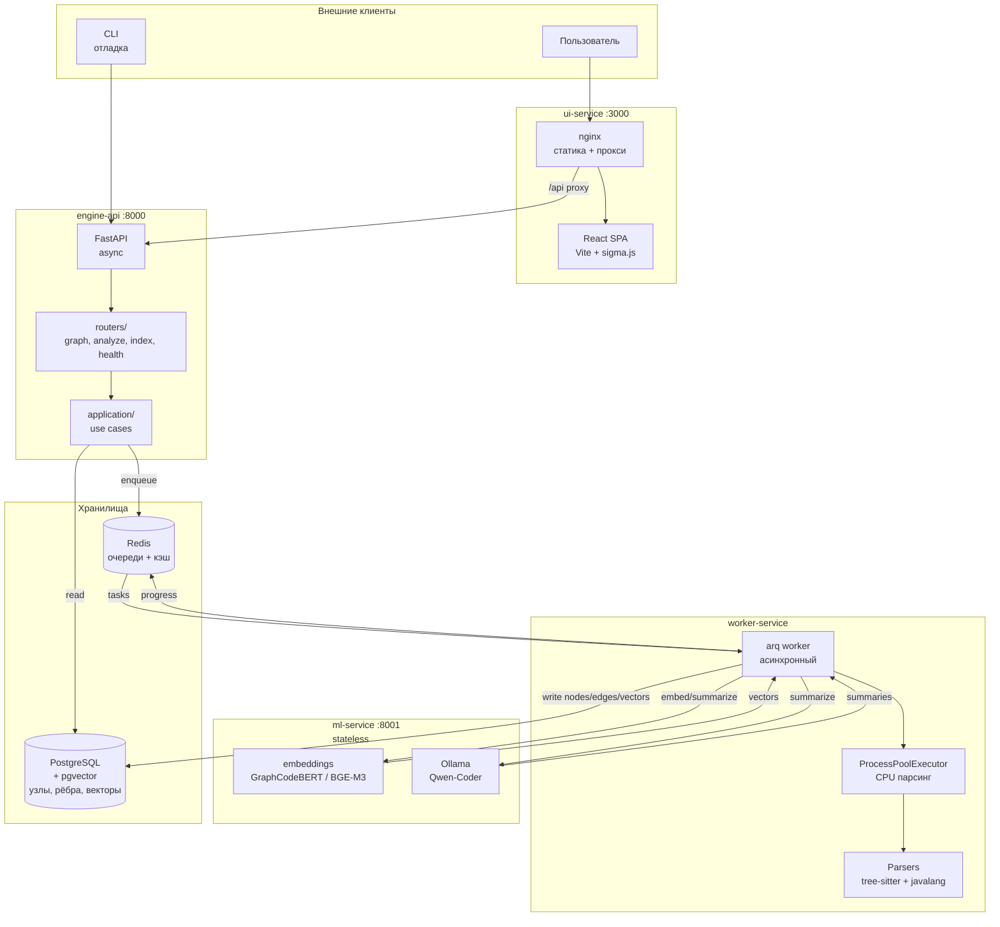
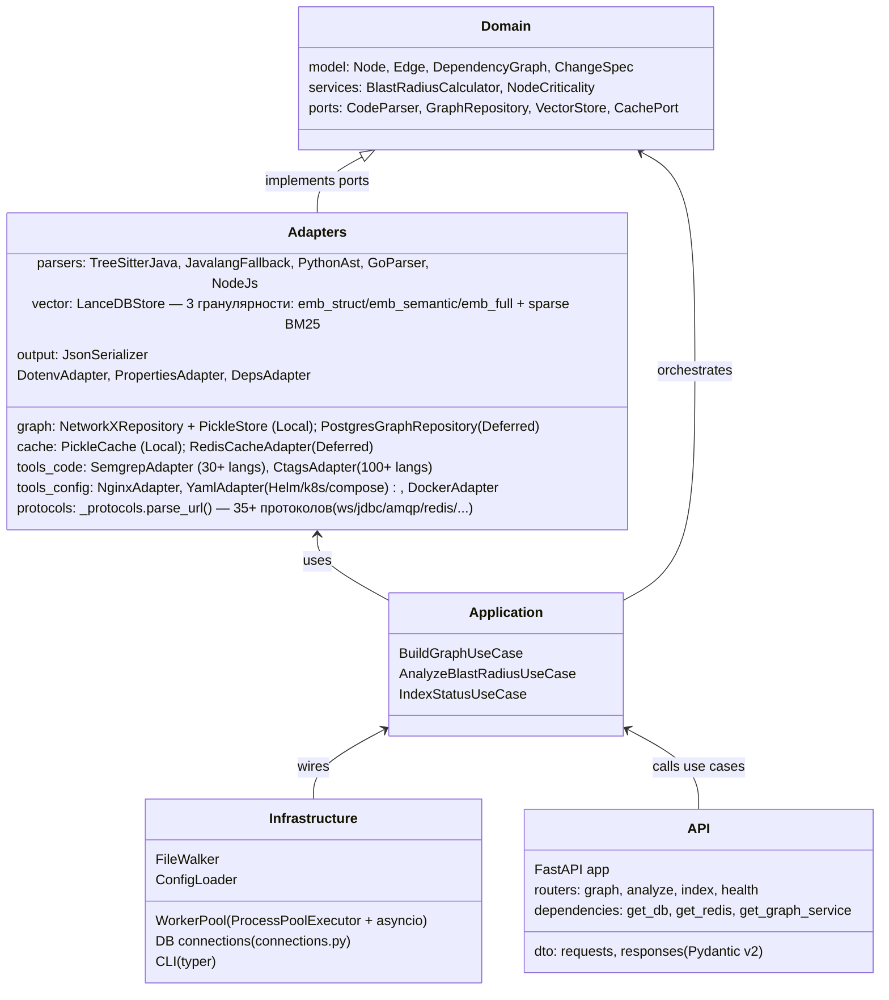
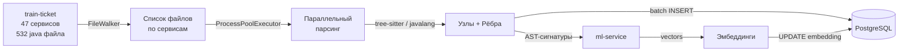
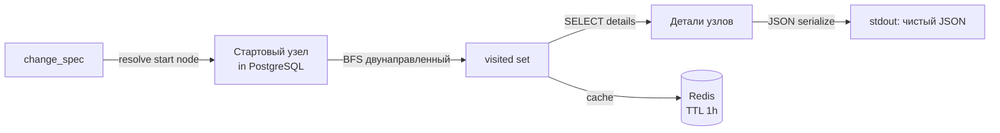

# Архитектура системы

**Связанные:** [ADR-006](adr/ADR-006-engine-architecture.md), [ADR-009](adr/ADR-009-microservices.md), [HOW_IT_WORKS.md](HOW_IT_WORKS.md)

---

## Сервисная топология



---

## Слои архитектуры (Hexagonal)



---

## Структура репозитория

```
blast-radius-engine/
│
├── services/
│   ├── engine-api/             # FastAPI + domain + adapters
│   │   ├── src/
│   │   │   ├── domain/         # Чистая бизнес-логика
│   │   │   ├── adapters/       # Реализации портов
│   │   │   ├── application/    # Use cases
│   │   │   ├── infrastructure/ # Workers, FileWalker, connections
│   │   │   └── api/            # FastAPI: routers, dto, main, deps
│   │   ├── Dockerfile
│   │   └── README.md
│   │
│   ├── worker-service/         # arq workers + BuildGraph
│   │   ├── src/
│   │   ├── Dockerfile
│   │   └── README.md
│   │
│   ├── ml-service/             # Stateless: embed + summarize
│   │   ├── src/
│   │   ├── Dockerfile
│   │   └── README.md
│   │
│   └── ui-service/             # React + Vite + nginx
│       ├── src/
│       ├── Dockerfile
│       └── README.md
│
├── docs/                       # Документация
│   ├── README.md               # ← Реестр (вы здесь)
│   ├── HOW_IT_WORKS.md
│   ├── ARCHITECTURE.md
│   ├── PLAN.md
│   ├── CHANGELOG.md
│   └── adr/                    # ADR-001 — ADR-013
│
├── docker-compose.yml
├── Makefile
├── pyproject.toml
└── requirements-dev.txt
```

---

## Поток данных при индексации



---

## Поток данных при запросе


