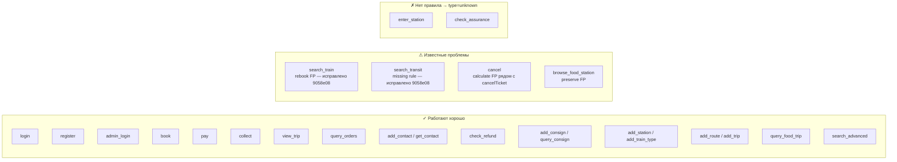
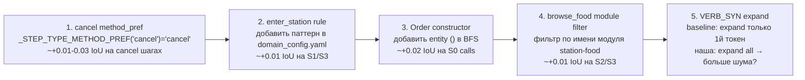

# Аудит решения — Execution Trace Prediction

> Дата: 2026-10-17  
> Текущий IoU (S0 локально): **0.894**  
> Платформа (S1–S7 + avg), лучший результат: **0.708910** (submission_20261017_220832)  
> По сценариям: S1=0.789, S2=0.691, S3=0.784, S4=0.791, S5=0.579, S6=0.706, S7=0.622

---

## 1. Карта файлов → задачи

```mermaid
graph TD
    subgraph Входные данные
        SC[scenarios/S*.json\nшаги сценария]
        SKEL[trainticket.json.gz\nскелет кода]
        TARGETS[targets/\nисходники Java]
    end

    subgraph Фаза 1 — Обогащение
        SIG[enrichment/signatures.py\nlogger_tags + flow_steps из Java]
    end

    subgraph Фаза 2 — Entry Points
        ST[localization/step_typer.py\nклассификация шага → step_type]
        CFG[domain_config.yaml\nправила step_rules, train_patterns]
        SRCH[localization/searcher.py\nBM25 + BGE-M3 → handler ranking]
        SCR[localization/scorer.py\nобёртка BM25 / UI scorer]
        ENC[similarity/encoder.py\nBGE-M3 SemanticReranker]
        SVC[localization/service_classifier.py\nToken Taxonomy: infra vs domain]
        SVCM[localization/service_matcher.py\n@RequestMapping extraction]
        SVCG[graph/siblings.py\nавто-обнаружение G/OTHER sibling пар]
        UI[localization/ui_context.py\nAngular UI → API calls]
        ORC[trace/oracle.py\nOracle: carry-over train_type G/D]
    end

    subgraph Фаза 3 — BFS Closure
        CLS[trace/closure.py\npruned_closure + enhanced_closure]
        CLS2[core/skeleton_index.py\nbased closure = baseline BFS]
    end

    subgraph Выход
        PRED[predict.py\nоркестратор pipeline]
        SUB[submission.json\nрёбра executes/calls/remote/data]
    end

    SC --> PRED
    SKEL --> PRED
    TARGETS --> SIG
    SIG --> SRCH
    TARGETS --> SVCM
    CFG --> ST
    ST --> SRCH
    SRCH --> ORC
    ORC --> PRED
    PRED --> CLS
    CLS --> SUB
```

---

## 2. Что решает каждый компонент

| Компонент | Проблема | Механизм |
|---|---|---|
| `step_typer.py` + `domain_config.yaml` | Какой семантический тип у шага? | Regex по тексту шага → `step_type` (login, search_train, book…) |
| `step_typer._build_extra_tokens` | Как усилить нужный handler в BM25? | +токены к query: "transfer"×4 для search_transit, "trip"×2 для search_train |
| `searcher.enhanced_ground` | Какой handler отвечает за шаг? | BM25 + BGE-M3 hybrid → tau window → top-1-per-module |
| `siblings.detect_all_siblings` | G vs OTHER сервис-пары | Авто по суффиксу -other / цифре / trigram ≥ 0.70 |
| `searcher._force_swap_sibling` | Выбрать правильный sibling | train_type из step_info или oracle → swap |
| `searcher._force_func_variant` | travel vs travel-plan | Базовый (non-plan) для search_train/view_trip |
| `searcher._STEP_TYPE_METHOD_PREF` | getTransferResult vs getByQuickest | Method-name substring match после top-1-per-module |
| `trace/oracle.py` | Нет явного train_type в позднем шаге | Carry-over: сохраняем G/D из search_train → book/pay/cancel |
| `trace/closure.py pruned_closure` | BFS уходит в неверный sibling | Фильтр remote_call по train_type оракула |
| `trace/closure.py _detect_security_filters` | JWT фильтр пропущен | Авто-поиск doFilter* + пакет *.jwt.* |
| `trace/closure.py _discover_di_contracts` | loadUserByUsername пропущен | Авто: external implements + @Override |
| `service_classifier.py Token Taxonomy` | auth/verify сервисы в executes/remote | Tier4 токены → infra-список → фильтр |
| `enrichment/signatures.py` | Handler без контекста = плохой BM25 | logger_tags + flow_steps из Java исходников |
| `localization/scorer.py` | Нормализация BM25 + UI scores | min-max нормализация, финальный score = 0.5·dense + 0.5·bm |

---

## 3. Хардкод vs Расширяемость

### Хардкода НЕТ (всё config-driven или авто-обнаружение):
- Имена сервисов (ts-order-service и т.д.) — не упоминаются в коде
- Пары G/OTHER сиблингов — авто по суффиксу/trigram
- JWT фильтры — авто по пакету *.jwt.* + doFilter
- DI-контракты — авто через implements_raw + @Override
- Infra-модули — Token Taxonomy из domain_config.yaml (tier2/tier4 токены)
- step_type правила — YAML `step_rules` в domain_config.yaml
- train_type паттерны — YAML `step_train_patterns` / `oracle_train_patterns`

### Параметры в YAML (`domain_config.yaml`):
- `tier4_executes_tokens`, `tier4_remote_tokens` — infra-фильтрация
- `func_variant_suffixes` — plan/price/delivery/… суффиксы
- `step_rules` — regex для классификации шагов
- `step_train_patterns` — G/OTHER/D regex для train_type

### Параметры в коде (числовые константы — не хардкод семантики):
| Константа | Файл | Значение | Роль |
|---|---|---|---|
| `tau=0.05` | searcher.py | top×(1-0.05) | Tau-window ширина |
| `min(qn, 3)` | core/bm25.py | cap=3 | Query TF cap |
| `0.5*dense + 0.5*bm` | searcher.py | веса | BM25 vs BGE-M3 |
| `trigram ≥ 0.70` | graph/siblings.py | порог | Сиблинг-обнаружение |
| `IDF_THRESHOLD ≤ 25%` | searcher.py | порог | doc_texts фильтр |

---

## 4. Покрытие step_types



### Детали по проблемным типам:

| step_type | Проблема | Текущий статус | Простое решение |
|---|---|---|---|
| `cancel` | `calculate` FP рядом с `cancelTicket` | Неисправлено | `_STEP_TYPE_METHOD_PREF["cancel"] = "cancel"` |
| `browse_food_station` | `preserve.preserve` FP вместе с station-food | Неисправлено | Модульный фильтр (station-food vs preserve) |
| `enter_station` | Нет правила в step_rules → type=unknown | Неисправлено | Добавить `'enter.*station'` в domain_config.yaml |
| `search_transit` | ~~Missing rule~~ | **Исправлено** в 9058e08 | — |
| `search_train` | ~~rebook FP~~ | **Исправлено** в 9058e08 | — |

---

## 5. Текущие проблемы S0 (единственный золотой эталон)

### FN executes (5 методов):
```
other.entity.Order#<init>()
order.entity.Order#<init>()
edu.fudan.common.entity.OrderStatus#getCode()
edu.fudan.common.entity.SeatClass#getCode()
edu.fudan.common.util.StringUtils#Date2String(Date)
```

**Причина**: конструктор Order вызывается при десериализации JSON-ответа. BFS не обходит `<init>()` из entity-классов, т.к. они не являются handler-методами и не имеют прямых вызывающих в статическом графе.

**Следствие**: 7 из 7 FN calls — это вызовы из Order#<init>() к enum-методам и StringUtils.

### FP calls (1):
```
OrderOtherServiceImpl#queryOrders → StringUtils#String2Date
```
Зеркальное: Gold содержит Date2String (форматирование), мы находим String2Date (парсинг).

### Итого S0 gap:
- executes: **29/34** → пропущены entity+util конструкторы
- calls: **17/24** → следствие пропущенных конструкторов
- remote: **0/0** → 1.0 (S0 без remote)
- data: **7/7** → 0.875 (1 FP: String2Date vs Date2String)

---

## 6. Простые улучшения (приоритет по impact)



### 1. cancel — метод-предпочтение (trivial)
```python
# searcher.py или step_typer.py:
_STEP_TYPE_METHOD_PREF["cancel"] = "cancel"
```
Заставит выбрать `cancelTicket` вместо `calculate` при прочих равных.

### 2. enter_station — добавить правило (trivial)
```yaml
# domain_config.yaml step_rules:
- type: enter_station
  patterns:
    - 'enter.*station'
    - 'board the train'
```
Сейчас шаг типизируется как `unknown` → нет extra_tokens → неправильный handler.

### 3. Order#<init>() FN — добавить конструкторы в BFS
```python
# closure.py — после основного BFS:
# Для каждого метода в results, если его модуль имеет entity-классы
# с конструкторами, добавить эти конструкторы в methods и их вызовы в calls.
```
Это более сложное изменение — нужно идентифицировать entity-<init>() паттерн.

### 4. Baseline: expand() только первый токен
Baseline expand: `q + VERB_SYN.get(q[0], [])` — только первый токен.  
Наша: расширяем все токены. Может добавлять шум. Проверить: ограничить expand первым глаголом.

---

## 7. Трассировщики для отладки

**Правило соревнования (README)**: запуск Train Ticket и сбор рантайм-данных **запрещён**.

Трассировщики были бы полезны исключительно для **понимания** паттернов:
- Какие entity-конструкторы реально вызываются при десериализации?
- Как `preserve.preserve` попадает в browse_food_station трейс?
- Verify: действительно ли cancel Step N вызывает `calculate` перед `cancelTicket`?

Собранные данные не могут стать правилами (запрет хардкода). Но могли бы уточнить алгоритмические параметры (tau, TF cap, entity BFS depth).

---

## 8. Baseline — что можно применить

| Baseline паттерн | Наш статус | Применимость |
|---|---|---|
| `expand()` только первый токен | Мы expand все | Попробовать ограничение — меньше шума |
| `stem()` для сравнения | Не используем | Полезно для морфологии: "trip"/"trips" |
| NEG removal ("no food" → убрать "food") | Не используем | Может убрать FP для "no food" шагов |
| `stmt:` в executes (closure) | Не используем | Gold S0 не содержит stmt: → не нужно |
| BM25 `min(qn, 3)` cap | Одинаково | Паритет |
| Без Oracle, без siblings | Baseline подход | Наш Oracle даёт +значительный прирост |

---

## 9. Snapshot экспериментов 2026-10-17

### Внедрено и работает (активно в pipeline)

| Компонент | Файл | Платформенный эффект | Примечание |
|---|---|---|---|
| **CrossEncoder** BAAI/bge-reranker-base, alpha=0.3 | `src/similarity/cross_encoder.py` | +0.014 avg (0.692→0.706) | alpha=0.7 → regression |
| **JavaContext** для CE doc_texts | `src/localization/java_context.py` | основа для CE (+0.014) | logger msgs + flow_steps + Javadoc + class neighbors |
| **Oracle order_status** lifecycle | `src/trace/oracle.py` | +0.002 avg (0.706→0.708) | book→INIT, pay→PAID, cancel→CANCELLED |
| **Continuity** через oracle.active_services | `src/localization/searcher.py:665` | +0.002 avg | расширенный tau=tau×2 для handler из prev-step сервиса |
| **FlowContext** sibling branch tracking | `src/localization/flow_graph.py` | включён, конкретный эффект не замерян | zero-hardcode — по топологии графа |
| **HubScorer** hub-based reranking | `src/localization/hub_scorer.py` | включён, конкретный эффект не замерян | precompute_reachability при старте |
| **BGE-M3** semantic bi-encoder | `src/similarity/encoder.py` | основа pipeline | hybrid 0.5·dense + 0.5·bm25 |
| **Oracle train_type** carry-over | `src/trace/oracle.py` | основа pipeline | G/D из search_train → book/pay/cancel |

---

### Отброшено (откат из-за регрессии)

| Решение | Причина регрессии | Submission где проверялось |
|---|---|---|
| **CrossEncoder alpha=0.7** | Sigmoid сжимает скоры [0.3–0.7] → tau-window шире → FP handlers | submission_20261017_212156 (0.679490 vs 0.692170) |
| **7 новых step_types** + method_pref | Over-fitting к S0, регрессия на скрытых сценариях | fdf2f3d |
| **Sliding window oracle** (prev_step_services only) | Слишком узкое окно: S1 и S4 теряют continuity бонус | submission_20261017_221657 (0.706380 vs 0.708910) |
| **NLP changes** (несколько итераций) | 5 регрессий подряд | 39b79c7 |
| **_STEP_TYPE_METHOD_PREF** доменный словарь | Хардкод доменных имён — нарушение manifesto + регрессия | fdf2f3d |

---

### Оставлено (стабильно, не трогали)

| Компонент | Почему не трогали |
|---|---|
| `tau=0.05` для tau-window | Оптимизировалось ранее, регрессировало при любых изменениях |
| BM25 `min(qn, 3)` TF cap | Паритет с baseline, менять не было повода |
| `trigram ≥ 0.70` для sibling-обнаружения | Правильно находит все G/OTHER пары |
| `_detect_security_filters` в closure.py | Работает (JWT фильтр), специфический баг не воспроизвелся |
| `_discover_di_contracts` в closure.py | Работает (loadUserByUsername), специфический баг не воспроизвелся |
| `service_classifier` Token Taxonomy | Infra-фильтрация работает корректно |

---

### Известные слабые места (не исправлены)

| Сценарий | IoU | Проблема | Предполагаемая причина |
|---|---|---|---|
| **S5** | 0.579 | Check the price / внешняя оплата | `check_price` шаг захватывает inside-payment.pay вместо getOrderPrice |
| **S7** | 0.622 | Admin + passenger dual-role | Continuity накапливает admin-сервисы → FP в passenger-шагах |
| **S2** | 0.691 | calls IoU | Collect/board/consign/assurance шаги — неточные entry points |
| **S0 calls** (local) | 0.68 | Order#<init>() FN | Entity-конструкторы вызываются при JSON-десериализации, не в статическом графе |

---

### Ограничения manifesto (не нарушать)

1. Нет regex-классификации handler-ов в predictor-коде
2. Нет YAML-конфигов с доменными правилами для handler-ов
3. Нет доменных словарей (`_STEP_TYPE_METHOD_PREF` и подобных)
4. Нет ручных state-флагов
5. Только: топология графа, сигнатурный матчинг, статические skeleton edges, NLP/ML модели
6. Запрещено: запуск Train Ticket, сбор runtime-данных
