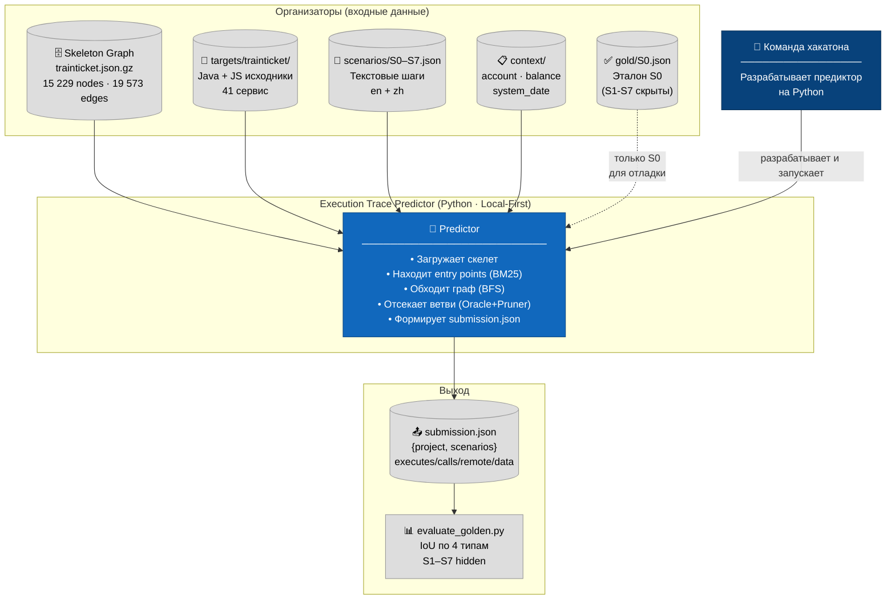
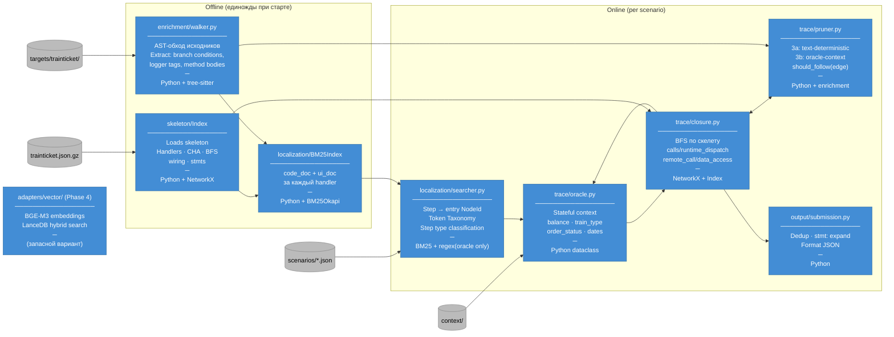
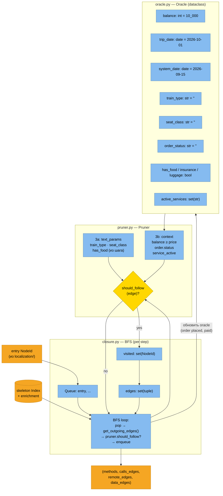
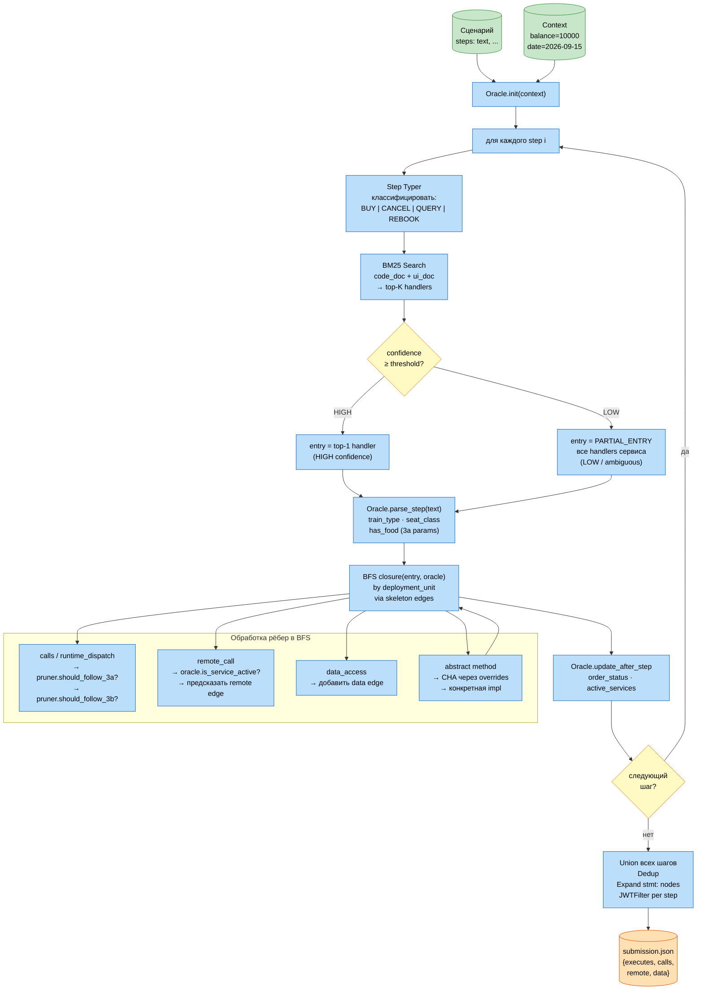
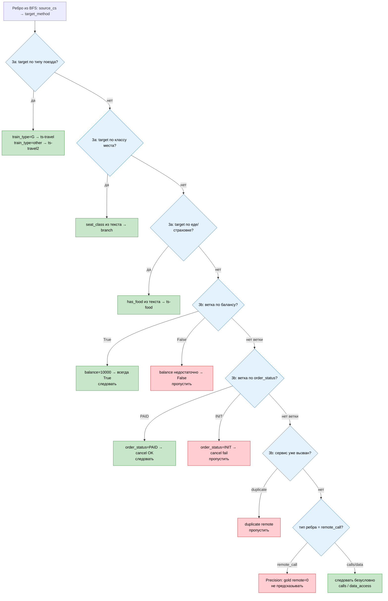
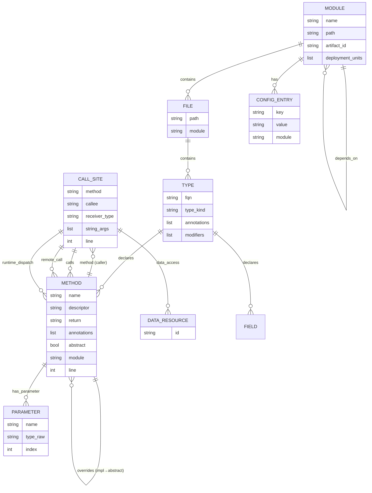
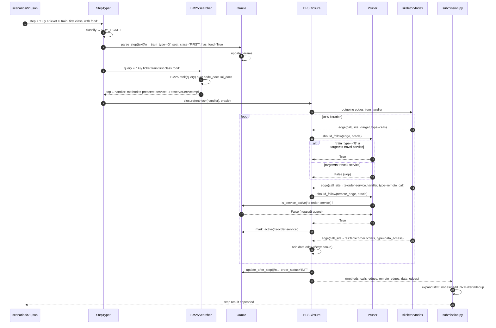
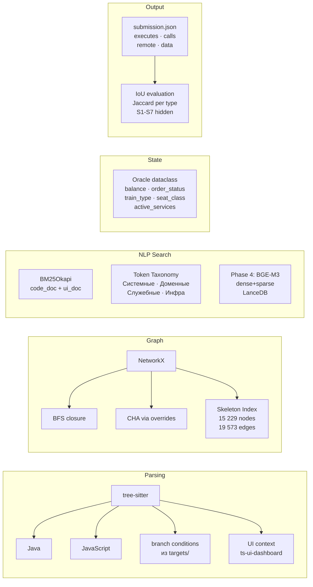

# Архитектурные диаграммы — Execution Trace Predictor

> C4-модель + детальные схемы ключевых компонентов.
> Технология · Подход · Условие · Результат · Переход · Связи

---

## C4 Level 1 — System Context

Что является входом, что системой, кто оценивает.

---

## C4 Level 2 — Container Architecture

Основные технологические блоки системы.

---

## C4 Level 3 — Component: trace/ (ядро предиктора)

Детали самого сложного контейнера — пошаговый обход с управлением состоянием.

---

## Пайплайн — End-to-End Flowchart

Полный путь от сценария до submission.json.

---

## Branch Selection — Схема ветвления

Как Oracle + Pruner принимают решения о следовании по рёбрам.

---

## Skeleton — Модель данных

Структура узлов и рёбер в trainticket.json.gz.

---

## Sequence — Обработка одного шага сценария

Детальный поток между компонентами для шага «купить билет».

---

## Стек технологий — Сводная карта

