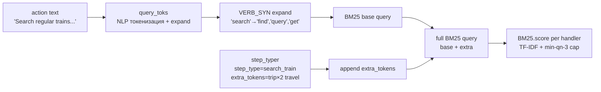
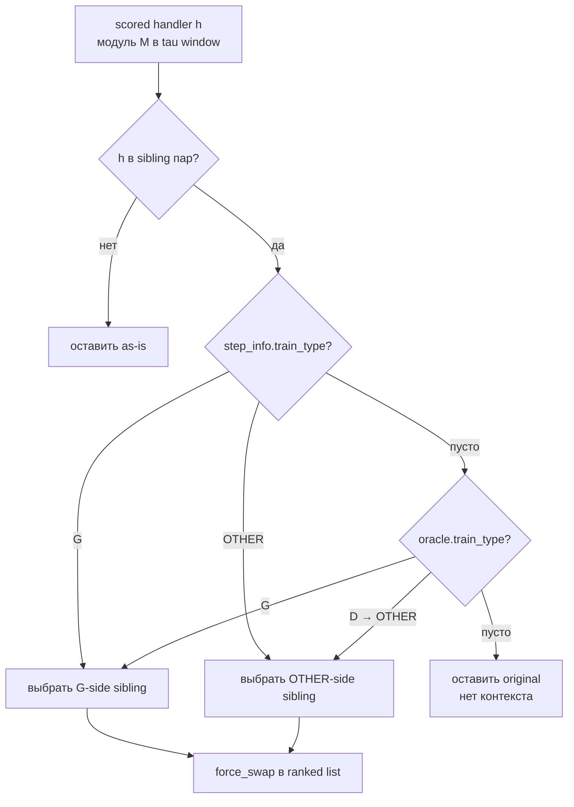
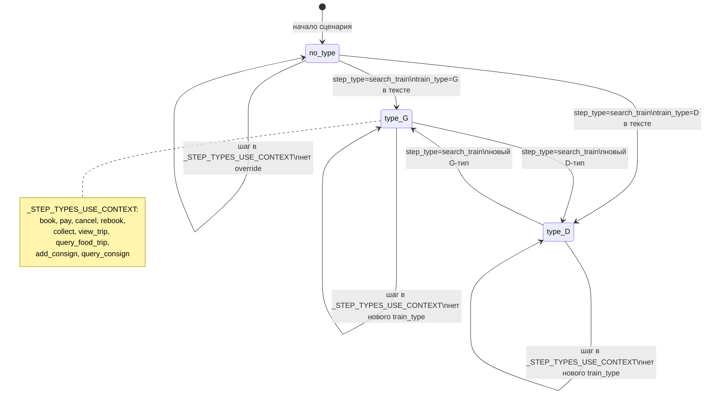

# Построение графа исполнения — Pipeline

> Как из сценария (список шагов) строится граф execution trace: entry points → BFS → рёбра.

---

## 1. Полный pipeline

```mermaid
flowchart TD
    scenario[Сценарий S\nn шагов action]

    subgraph Phase2["Фаза 2 — Entry Point Localisation"]
        classify[step_typer.classify\naction → StepInfo\nstep_type + train_type + extra_tokens]
        oracle_step[oracle.parse_step\nобновить carry-over G/D]
        bm25q[BM25 query\n= NL-токены + extra_tokens]
        score_bm[Scorer.score_all\nBM25 scores все handlers]
        score_dense[SemanticReranker.rerank\nBGE-M3 dense scores]
        normalize["min-max normalize\nfinal = 0.5·dense + 0.5·bm"]
        tau[tau window\nhandlers ≥ top×0.95]
        top1[top-1-per-module\nодин handler на сервис]
        check_pref{method_pref?}
        swap_pref[swap to preferred\nmethod name match]
        check_sib{sibling pair?}
        swap_sib[force_swap_sibling\nвыбрать G или OTHER side]
        check_fv{func_variant pair?}
        swap_fv[force_func_variant\nbasic vs plan service]
        entries[entries set\nмножество entry points шага]
    end

    accum[accumulate entries\nпо всем шагам]

    subgraph Phase3["Фаза 3 — BFS Closure"]
        bfs[pruned_closure\nBFS через calls + remote_call + data]
        remote_check{remote_call target}
        remote_filter[фильтр sibling\nневерный тип пропускается]
        sec[+Security Filters\ndoFilter* в *.jwt.*]
        di[+DI Contracts\nexternal implements + @Override]
        infra[infra filter\nToken Taxonomy → убрать auth/verify]
        exc[exception ctor filter\nException/Error <init> → убрать]
    end

    result[submission.json\nexecutes / calls / remote / data]

    scenario --> classify
    classify --> oracle_step
    oracle_step --> bm25q
    bm25q --> score_bm
    score_bm --> score_dense
    score_dense --> normalize
    normalize --> tau
    tau --> top1
    top1 --> check_pref
    check_pref -- да --> swap_pref
    check_pref -- нет --> check_sib
    swap_pref --> check_sib
    check_sib -- да --> swap_sib
    check_sib -- нет --> check_fv
    swap_sib --> check_fv
    check_fv -- да --> swap_fv
    check_fv -- нет --> entries
    swap_fv --> entries
    entries --> accum
    accum --> bfs
    bfs --> remote_check
    remote_check -- "train_type=G → пропустить OTHER sibling" --> remote_filter
    remote_check -- "train_type=D → пропустить G sibling" --> remote_filter
    remote_filter --> bfs
    bfs --> sec
    sec --> di
    di --> infra
    infra --> exc
    exc --> result
```



---

## 2. Построение BM25-документов (перед pipeline)

```mermaid
flowchart LR
    subgraph Index Build ["_build_index — однократно при старте"]
        SK[skeleton.json.gz\nhandlers: nid + verb + path + params]
        JV[targets/ Java-источники\nflow_steps, logger_tags]
        ANG[Angular UI\nfrontend call sites → handler mapping]

        SK --> HD[handler_docs\nnid → {verb path name params}]
        JV --> EN[enrichment/signatures.py\nbody_tokens per nid]
        ANG --> UI[ui_context.py\nui_tokens per nid]

        HD --> SC[Scorer BM25\ncode_doc = handler_doc + body_tokens\nui_doc = ui_tokens]
        EN --> SC
        UI --> SC

        SC --> BGE[SemanticReranker\nTF-IDF filter → doc_texts\nBGE-M3 embeddings]
    end
```

---

## 3. BM25-запрос — что входит



---

## 4. Sibling disambiguation — G/OTHER



---

## 5. Oracle carry-over



---

## 6. Граф рёбер — типы и источники

| Тип ребра | Источник в skeleton | Фильтрация | Gold покрытие |
|---|---|---|---|
| `executes` | entry points → все methods в BFS | infra (Token Taxonomy), exception ctor | S0: 29/34 |
| `calls` | skeleton.calls (статические вызовы) | infra, exception ctor | S0: 17/24 |
| `remote` | skeleton.wiring.remote_call + message_delivery | infra, sibling wrong-side (pruned) | S0: 0/0 (нет в S0) |
| `data` | skeleton.wiring.data_access | нет | S0: 7/7 |

---

## 7. Формат submission

```
scenario:<S_id>  --executes-->  method:<module>:<fqn>#method(params)
method:<m1>      --calls-->     method:<m2>
method:<m1>      --remote-->    method:<m2> (другой сервис)
method:<m1>      --data-->      res:table:<table_name>
```

Метрика: IoU = |P ∩ G| / |P ∪ G| по каждому из 4 типов, среднее по сценарию.  
Итог = среднее по сценариям с эталоном.
