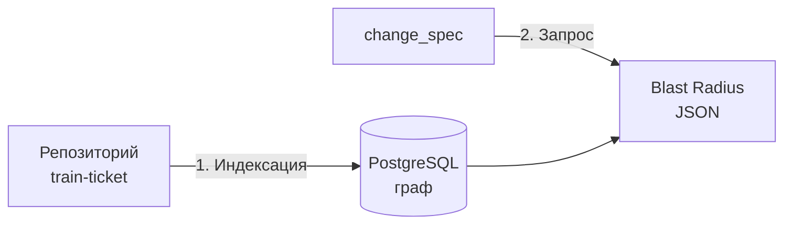
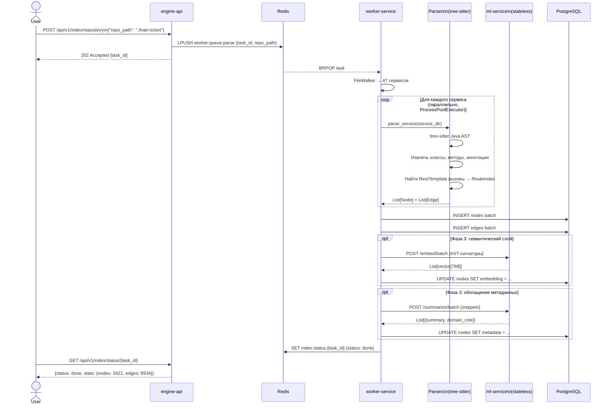
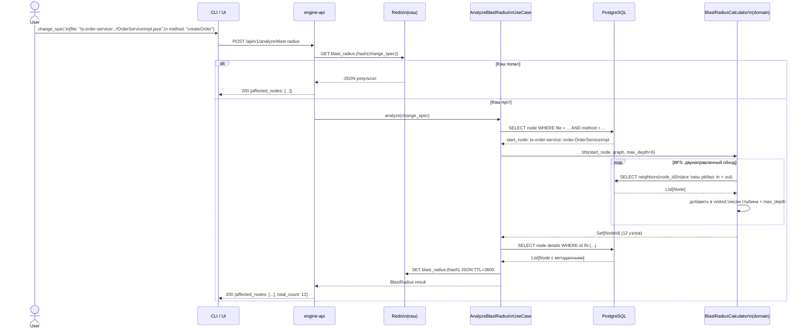
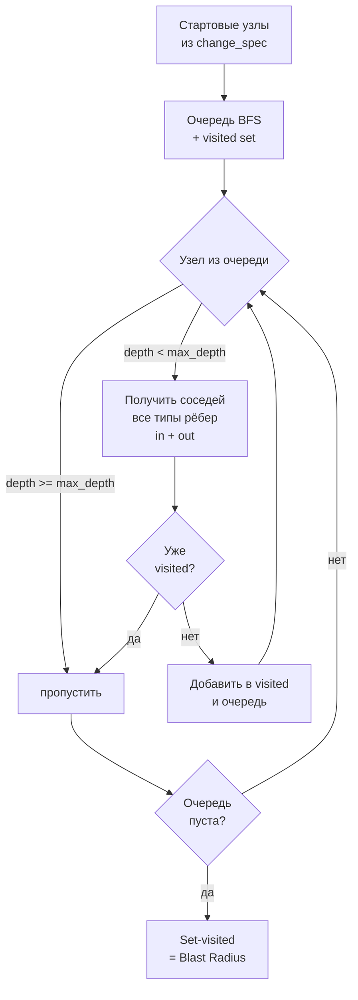
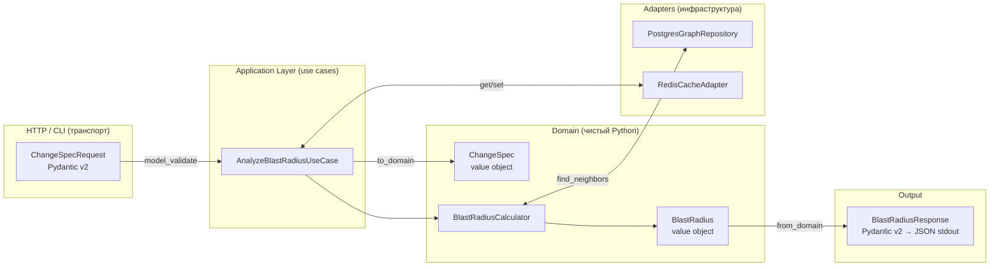
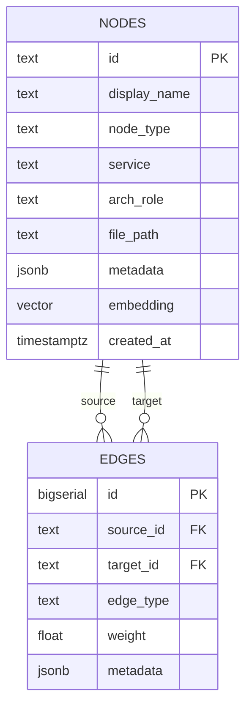

# Как работает Blast Radius Engine

**Связанные:** [ADR-003](adr/ADR-003-fallback-strategy.md), [ADR-005](adr/ADR-005-traversal-strategy.md), [ADR-006](adr/ADR-006-engine-architecture.md), [ADR-009](adr/ADR-009-microservices.md)

Движок решает одну задачу: по описанию изменения в коде (`change_spec`) вернуть множество всех узлов системы, которые это изменение затронет — **Blast Radius**.

---

## Два главных потока



**Поток 1 — Индексация** выполняется один раз (или при обновлении репо): строит граф зависимостей и сохраняет в NetworkX + pickle (Local Mode).

**Поток 2 — Запрос** выполняется при каждом запросе: загружает граф из pickle, запускает BFS от изменённого узла, возвращает затронутые узлы.

> **Local Mode** (текущий): NetworkX + pickle; `python -m blast_radius analyze ... | jq .` — без Docker/PostgreSQL/Redis.  
> **Production Mode** (Deferred): PostgreSQL + pgvector + Redis + FastAPI — ADR-007–010.

---

## Поток 1: Индексация репозитория

### Последовательность



### Tool Adapter Layer — конфиги и зависимости

До запуска языковых парсеров `ToolRegistry` сканирует конфиги репозитория:

```
Репо
 ├── docker-compose.yml   → YamlAdapter    → SERVICE_DEF, ENV_ACCESS
 ├── **/nginx.conf        → NginxAdapter   → PROXY_ROUTE, listen-порты
 ├── **/Dockerfile        → DockerAdapter  → SERVICE_DEF + EXPOSE-порты
 ├── **/.env              → DotenvAdapter  → ENV_ACCESS + URLs (redis://, amqp://...)
 ├── **/application.properties → PropertiesAdapter → CALLS_DB, ASYNC_CALL
 └── **/pom.xml           → DepsAdapter    → IMPORT + tech_hint (db:mysql, mq:rabbitmq)
```

`_protocols.py` парсит 35+ протоколов (`ws`, `wss`, `jdbc:*`, `amqp`, `kafka`, `nats`, …) — везде.  
Все `Finding` попадают в единый `AnalysisResult` → JSON.

### Что происходит внутри парсера

```mermaid
flowchart TD
    F[Java-файл] --> TS{tree-sitter\nпарсинг}
    TS -->|OK| AST[AST-дерево]
    TS -->|ошибка| JL[javalang\nfallback]
    JL -->|OK| AST
    JL -->|ошибка| PP[PARTIAL_PARSED\nузел-заглушка]

    AST --> CLS[Классы + интерфейсы\n@Service @Controller ...]
    AST --> MET[Методы + сигнатуры]
    AST --> ANN[Аннотации\n@RequestMapping ...]
    AST --> IMP[Импорты]
    AST --> REST[RestTemplate вызовы]

    REST --> RES{Резолвинг\nцепочка ADR-003}
    RES -->|литерал| SVC[ребро CALLS_SERVICE\nк конкретному сервису]
    RES -->|@Value| ENV[ENV_INDEX lookup\nдокер-компоуз]
    RES -->|динамика| UNK[UnknownDynamicTarget\nUSES_MAGIC_CALL]

    CLS --> N[Узлы графа]
    MET --> N
    ANN --> N
    SVC --> E[Рёбра графа]
    IMP --> E
    UNK --> E
```

---

## Поток 2: Запрос Blast Radius

### Последовательность



### Алгоритм BFS внутри



---

## Как данные проходят через слои архитектуры



**Правило:** домен ничего не знает о HTTP, PostgreSQL или Redis. Конвертация — на границах слоёв.

---

## Структура данных в PostgreSQL



---

## Пример: что происходит при изменении `OrderServiceImpl#createOrder`

```
change_spec:
  file:   ts-order-service/src/main/java/order/service/OrderServiceImpl.java
  class:  order.OrderServiceImpl
  method: createOrder

Стартовый узел:
  ts-order-service::order.OrderServiceImpl#createOrder  (METHOD)

Обход (BFS, max_depth=6):

depth=1 (вверх CONTAINS):
  → ts-order-service::order.OrderServiceImpl  (CLASS)

depth=1 (вниз CALLS из метода):
  → ts-order-service::order.OrderRepository#findByTravelDate  (METHOD)

depth=1 (вбок CALLS_SERVICE):
  → ts-station-service::stationinfo.StationInfoController#queryForNameList  (METHOD)

depth=2 (вверх от StationInfoController):
  → ts-station-service::stationinfo.StationInfoController  (CLASS)
  → ts-station-service  (SERVICE)

depth=2 (вверх от OrderServiceImpl):
  → ts-order-service  (SERVICE)

depth=2 (вверх от OrderRepository):
  → ts-order-service::order.OrderRepository  (CLASS/INTERFACE)

Итого: 8 узлов
Blast Radius: {
  "ts-order-service::order.OrderServiceImpl#createOrder",
  "ts-order-service::order.OrderServiceImpl",
  "ts-order-service::order.OrderRepository#findByTravelDate",
  "ts-station-service::stationinfo.StationInfoController#queryForNameList",
  "ts-station-service::stationinfo.StationInfoController",
  "ts-station-service",
  "ts-order-service",
  "ts-order-service::order.OrderRepository"
}
```

---

## Связанные документы

- [ADR-002](adr/ADR-002-graph-schema.md) — типы узлов и рёбер
- [ADR-003](adr/ADR-003-fallback-strategy.md) — как разрешаются межсервисные вызовы
- [ADR-005](adr/ADR-005-traversal-strategy.md) — параметры BFS и обоснование `max_depth=6`
- [ADR-008](adr/ADR-008-storage-architecture.md) — схема PostgreSQL, Redis-очереди
- [ADR-009](adr/ADR-009-microservices.md) — какой сервис что делает
- [ADR-011](adr/ADR-011-config-file-parsers.md) — RouteIndex и ENV_INDEX
- [ARCHITECTURE.md](ARCHITECTURE.md) — статичная схема компонентов
