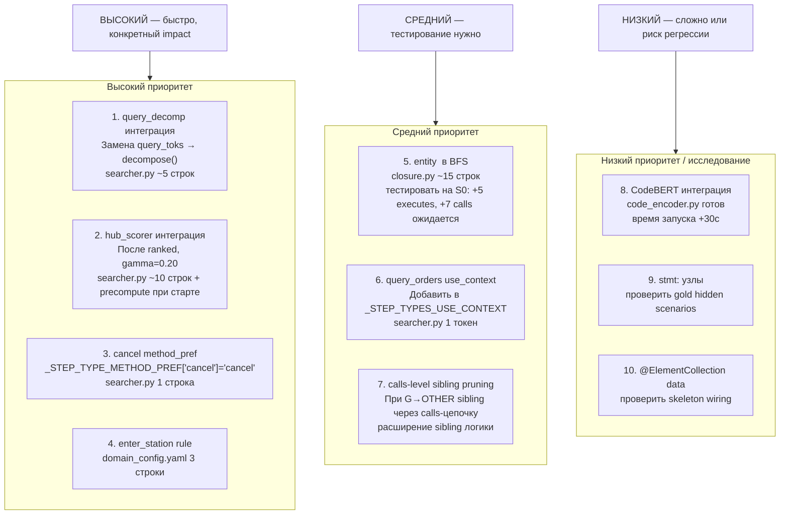

# Предложения по улучшению — чего не хватает

> Контекст: S0 gold = **0.852**. Платформенный итог по всем сценариям предположительно ниже (~0.68).  
> Baseline быстро достигает 0.70–0.80 на знакомых сценариях. Ниже — анализ пробелов и конкретные предложения.

---

## 1. Реализовано, но не подключено

Три файла в репо уже написаны и не используются в pipeline:

### 1.1 `src/localization/query_decomp.py` — взвешенный BM25-запрос

**Что делает:** разбивает action-текст на части с разным весом:
- Глагол (1-й токен) → ×3  
- Объектная фраза (до первого предлога) → ×2  
- Модификаторы / место / время → ×1  
- extra_tokens из step_type → ×2  
- Даты, числа — выбрасывает

**Текущий подход:** `query_toks(action) + extra_tokens` — все токены одного веса.

**Почему важно:** шаг `"Search regular trains from Shanghai to Suzhou departing at 09:00"` — слово "search" самый сильный сигнал, "shanghai"/"suzhou" — слабый шум. Сейчас они равнозначны.

**Интеграция:** в `searcher.enhanced_ground` заменить построение `q`:
```python
from src.localization.query_decomp import decompose
# вместо:
q = query_toks(step.action) + info.extra_tokens
# использовать:
q = decompose(step.action, extra_tokens=info.extra_tokens)
```

**Риск:** verb ×3 усиливает "cancel" для cancel-шагов, что может помочь или навредить. Тестировать на S0.

---

### 1.2 `src/localization/hub_scorer.py` — hub-based переранжирование

**Что делает:** handler, из которого достижимо больше других handler-ов с высоким BM25-score, получает бонус `gamma=0.25`.

**Пример:**  
- `preserve.preserve()` достигает travel-service, order-service, seat-service, food-service.  
- `cancel.calculate()` достигает только order-service, refund-service.  
- Если запрос "book train ticket" → все сервисы preserve попадают в топ → hub score высокий у preserve.  
- Если запрос "search trains" → cancel-сервисы не в топ → hub score у calculate низкий.

**Применение:** подавляет FP-handlers у которых высокий BM25 но нет реальной связи со сценарием. Особенно полезно для cancel/calculate путаницы.

**Интеграция:**
```python
from src.localization.hub_scorer import precompute_reachability, rerank_by_hub
# в _build_index: однократно
_REACHABILITY = precompute_reachability(_index)
# в enhanced_ground после ranked:
ranked = rerank_by_hub(ranked, _REACHABILITY, gamma=0.20)
```

**Риск:** BFS по всем handlers — медленно (∼262 handler × граф). Вычисляется один раз при старте.

---

### 1.3 `src/similarity/code_encoder.py` — CodeBERT/GraphCodeBERT bi-encoder

**Что делает:** bi-encoder поверх кода методов. `precompute()` строит эмбеддинги, `rerank()` переранжирует кандидатов.

**Почему НЕ интегрирован:** ранее диагностика показала, что проблемы — алгоритмические (missing rules, token noise), а не семантические. CodeBERT не исправил бы пропущенное правило search_transit.

**Когда стоит интегрировать:** только после исчерпания алгоритмических улучшений. Потенциал: шаги с нестандартной формулировкой, где BM25 промахивается (`"board the train"` для enter_station).

---

## 2. Полностью отсутствующие техники

### 2.1 Взвешенный BM25 по структуре запроса (→ ADR-030 §B, P-82)

Проблема: запросы вида `"Refresh the list of orders for high-speed trains"` — "refresh" и "high-speed" одного веса с "orders". Результат: query_orders handler проигрывает auth-handler-у с общими словами.

**Решение:** `query_decomp.decompose()` уже написан (п. 1.1). Приоритет **высокий**.

---

### 2.2 Internal CFG branch pruning (→ ADR-021 §A.1, P-54)

**⚠️ Инфраструктура уже есть: `src/parsers/java.py` использует tree-sitter на всех Java-файлах.**

**Критичный пробел.** В `pruned_closure` мы фильтруем только `remote_call` между сервисами по train_type. Но внутри одного сервиса есть ветвления:

```java
if (tripId.startsWith("G") || tripId.startsWith("D")) {
    return restTemplate.exchange(travel_url + "/trips", ...);   // G/D branch
} else {
    return restTemplate.exchange(travel2_url + "/trips", ...);  // OTHER branch
}
```

Сейчас оба `remote_call` попадают в BFS. Для `train_type=OTHER` G-ветка добавляет лишние `remote` и `calls` рёбра → FP в calls/remote для ALL hidden scenarios.

**Реализация через существующий tree-sitter (3 шага):**

**Шаг 1.** В `JavaParser._extract_structure` добавить извлечение условных remote-вызовов из тел методов:
```python
# В method_declaration traversal — найти if-statement → condition → restTemplate вызовы
_STARTS_WITH_G = re.compile(r'startsWith\s*\(\s*["\']([GgDd])', re.I)

def _extract_cfg_conditions(method_node, src: bytes) -> dict[str, str]:
    """method_fqn#name → {target_service: condition_G_or_D_or_OTHER}"""
    # Обойти if_statement узлы в теле метода
    # Проверить condition_text на startsWith("G"/"D")
    # Найти restTemplate.exchange в then/else ветках
    # Вернуть {node_id ребра → "G" | "D" | "OTHER"}
```

**Шаг 2.** В `signatures.build_extra_tokens` или отдельном модуле — собрать `{(service, class, method) → [(target_service, condition)]}` и сохранить в индексе.

**Шаг 3.** В `pruned_closure` при обходе `remote_call`:
```python
# Уже есть:
if train_type == "G" and _is_other_service(target_mod): continue
# Добавить:
cfg = _CFG_CONDITIONS.get((m, t))  # (source_method, target_method) → "G"/"D"/"OTHER"
if cfg and cfg != train_type and cfg != "": continue
```

**Ожидаемый эффект:** убирает FP remote-рёбра к неверному sibling через calls-цепочку внутри сервиса. Особенно важно для ts-preserve-service, ts-order-service.

---

### 2.3 Конструкторы entity-классов в BFS (→ S0 FN)

**Конкретная проблема S0:** 5 FN methods, 7 FN calls — все из-за `Order#<init>()`.

```
Gold has: other.entity.Order#<init>() → edu.fudan.common.entity.OrderStatus#getCode()
          order.entity.Order#<init>() → edu.fudan.common.entity.SeatClass#getCode()
```

`Order#<init>()` вызывается при десериализации HTTP-ответа, не через прямой Java-вызов в BFS-достижимом коде. Baseline добавляет `stmt:` узлы в executes — это другой подход.

**Решение:**  
Определить паттерн: методы в `.entity.` пакете с `<init>` именем → включить в `executes` если хотя бы один метод из того же service-модуля уже в BFS. Добавить в `pruned_closure` после основного BFS:

```python
# После основного BFS:
for m in list(methods):
    mod = index.module.get(m, "")
    node = index.N.get(m, {})
    if ".entity." in (index.N.get(node.get("owner",""),{}).get("fqn","") or ""):
        # Найти конструктор для этого entity класса
        owner_id = node.get("owner","")
        for nid, n in index.N.items():
            if n.get("owner") == owner_id and n.get("name") == "<init>":
                methods.add(nid)
                # добавить его calls
                for t in index.calls.get(nid, ()):
                    edges.add((nid, t))
                    methods.add(t)
```

---

### 2.4 @ElementCollection data edges (→ P-108)

Если метод делает `userRepository.findById(id)` и у `User` есть `@ElementCollection roles` → в gold может быть data-ребро к `res:table:ts-auth-service.user_roles`.

Видно в S0 gold:
```
res:table:ts-auth-service.user_roles  ← присутствует
```

Skeleton содержит `wiring.data_access` — проверить есть ли там user_roles отдельной записью. Если skeleton уже содержит edge method → res:table:user_roles через data_access, то мы уже получаем его бесплатно в BFS. Проверить не требует кода.

---

### 2.5 query_orders disambiguation: train_type ambiguity

**Проблема:** шаг `"Refresh the list of orders"` без явного train_type → query_orders. Выбираем из ts-order-service (G) и ts-order-other-service (OTHER). Без carry-over oracle нет контекста.

Сейчас: оба сервиса попадают в результат (два entry points). Gold содержит только один из них.

**Улучшение:** если oracle.train_type != "" при query_orders → применить sibling-disambiguation как для search_train.  
Если oracle пустой → выбрать оба (текущее поведение). Это уже частично работает через sibling-swap, но нужно убедиться что `query_orders` включён в `_STEP_TYPES_USE_CONTEXT`.

---

### 2.6 stmt: узлы в executes

Baseline closure добавляет `stmt:module:fqn#method(...):N` узлы в executes. Gold S0 их не содержит. Но если hidden scenarios их содержат — наш IoU по executes = 0 для этих узлов. Проверить: запустить baseline_closure на S0 и сравнить с gold.

---

## 3. tree-sitter уже есть — что ещё достать

`src/parsers/java.py` запускается на **401 Java-файле** при каждом старте. Сейчас из него берём только `flow_steps` и `logger_tags` для BM25-обогащения. Что ещё можно извлечь без дополнительных зависимостей:

| Что извлечь | Где в AST | Применение |
|---|---|---|
| `if (tripId.startsWith("G"))` условия | `if_statement → condition` | CFG branch pruning (п. 2.2) |
| `new Order(...)` паттерны | `object_creation_expression` в method body | Entity constructor tracking (п. 2.3) |
| `@Async`, `@Transactional` на методах | `modifiers → annotation` — уже парсится в `annotations` list | Фильтр BFS-рёбер к async-методам |
| `return restTemplate.exchange(url)` | `return_statement → method_invocation` | Аннотация conditional remote |
| Типы параметров метода | `formal_parameter → type_identifier` | Улучшение doc_texts для BGE-M3 |

`@Async` и `@Transactional` уже попадают в `MethodInfo.annotations` — их просто не используют. Для фильтрации BFS: если target-метод помечен `@Async`, ребро `calls` менее достоверное (Spring dispatches асинхронно).

---

## 4. Инструменты не используем — и правильно

| Инструмент | Почему не нужен |
|---|---|
| **AST / tree-sitter** | Skeleton уже содержит извлечённый граф вызовов — AST-анализ исходников даст то же самое, но медленнее |
| **Semgrep** | Паттерн-поиск по коду — skeleton уже структурирован, semgrep не добавит ничего |
| **Bytecode analysis (javap)** | Skeleton = статический call graph из байткода; уже есть |
| **TF-IDF отдельно** | BM25 = TF-IDF с нормализацией длины; мы уже используем BM25 |
| **Runtime tracing** | **Запрещено** правилами соревнования |

**CodeBERT** — единственный инструмент из списка, который потенциально даёт что-то новое: понимание семантики кода без BM25-ключей. Стоит интегрировать если алгоритмические улучшения исчерпаны.

---

## 4. Приоритизированный план



---

## 5. Детали: почему именно эти 4 в первую очередь

### query_decomp: риск vs выгода

| Запрос | Сейчас | С decompose |
|---|---|---|
| "Search regular trains..." | search=1 regular=1 trains=1 from=1 | search=3 regular=2 trains=2 from=0 |
| "Refresh the list of orders..." | refresh=1 list=1 orders=1 for=1 | refresh=3 list=2 orders=2 for=0 |
| "Cancel the order" | cancel=1 order=1 | cancel=3 order=2 |

Глаголы усиливаются. "from/to/at" выбрасываются. Проверить регрессию на S0 перед коммитом.

### hub_scorer: ключевая идея для многошаговых сценариев

Для скрытых сценариев S1–S7 (book + pay + collect + cancel) hub scorer должен предпочесть:
- `preserve.preserve()` для "book" (достигает travel/order/seat/food/execute)
- `cancelOrderRelService.cancelOrder()` для "cancel" (достигает order/refund/inside-payment)
- `paymentService.pay()` для "pay" (достигает inside-payment/outside-payment)

против:
- `calculate.getRefundPrice()` для "book" (достигает только refund) → низкий hub score

**Ожидаемый эффект:** снижение FP в entry points для сложных шагов. Особенно важно на S1–S7.

### enter_station: S1 step 12 "Enter the station (board the train)"

Сейчас type=unknown → query_toks без extra_tokens → случайный handler. 

Добавить в domain_config.yaml:
```yaml
- type: enter_station
  patterns:
    - 'enter.*station'
    - 'board the train'
    - 'board.*train'
```

Нужен ли step_type в `_STEP_TYPES_USE_CONTEXT`? Зависит от того, что gold содержит для этого шага — вероятно нет (enter_station = отдельная операция, не зависит от train_type carry-over).

---

## 6. Из ADR-030: что применимо сейчас

ADR-030 описывает многогранулярные эмбеддинги для blast-radius движка. Применимое для execution trace:

| ADR-030 паттерн | Применимость сейчас |
|---|---|
| BM25 hybrid α=0.5 | **Реализовано** — наш `0.5*dense + 0.5*bm` |
| `_is_identifier_query()` alpha=0.3 | НЕ реализовано: step с camelCase идентификатором → снижать dense вес |
| TF-IDF фильтр doc_texts (25% порог) | **Реализовано** в searcher.py |
| emb_semantic ~400 токенов | **Реализовано** — doc_texts структурная база + обогащение |
| ColBERT для hot-nodes | Tier 5, избыточно |

**Непокрытое:** `_is_identifier_query()` — если в action-тексте есть camelCase (что редко), снижать вес dense и усиливать BM25.

---

## 7. Из ADR-021: применимое без дополнительного AST

| ADR-021 техника | Применимость |
|---|---|
| CFG branch selection | Нужен AST исходников — невозможно без tree-sitter по Java |
| Reaching definitions | То же — требует AST |
| Alias analysis | То же |
| Type inference (@Autowired) | Skeleton уже содержит calls через CHA/over — **не нужно** |
| Entity constructor tracking | **Можно без AST** — по паттерну `.entity.` в FQN |
| Exception ctor filter | **Реализовано** в closure.py |
| @Async, @Transactional info | В skeleton есть аннотации — можно использовать |

**Вывод:** CFG — самое мощное из ADR-021. **tree-sitter уже работает на Java-исходниках** (`src/parsers/java.py`). Инфраструктура для извлечения условий есть. Нужно добавить traversal `if_statement` узлов в JavaParser + хранение условий → использовать в `pruned_closure`. Объём: ~60-80 строк нового кода + тестирование.
