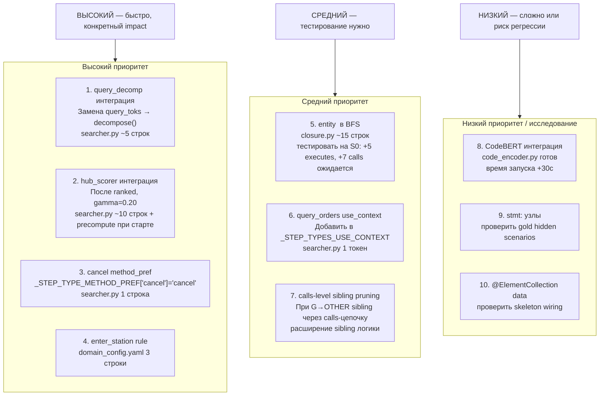

# Предложения по улучшению — чего не хватает

> Контекст: S0 gold = **0.852**. Текущий платформенный результат: **0.7683** (S1=0.807, S2=0.737, S3=0.802, S4=0.808, S5=0.741, S6=0.801, S7=0.683). Лучший результат — P1.3 консервативная + SP.1/SP.2/SP.3.  
> Слабые сценарии: S2=0.737 (train_type D), S7=0.683 (admin+passenger dual-role).
>
> **Локальный прогресс vs nlp.json (2026-10-19):** avg 0.567 → **0.612** (+0.045) после исправлений:
> - `ts-verification-code-service` убран из `tier4_executes_tokens` в `domain_config.yaml` → разблокирован в BFS (5 TP × 8 сценариев)
> - Spring Security DI-contracts (`loadUserByUsername`, `getAuthorities`, `isEnabled` и др.) добавлены в `_SKIP` → убраны 6-7 FP × 8 сценариев
> - `_detect_security_filters` (JWT FilterChain) убран → ещё -1 FP × 8

---

## 1. Реализовано, но не подключено

Три файла в репо уже написаны и не используются в pipeline:

### 1.1 `src/localization/query_decomp.py` — взвешенный BM25-запрос

**Что делает:** разбивает action-текст на части с разным весом:
- Глагол (1-й токен) → ×3  
- Объектная фраза (до первого предлога) → ×2  
- Модификаторы / место / время → ×1  
- extra_tokens из step_type → ×2  
- Даты, числа — выбрасывает

**Текущий подход:** `query_toks(action) + extra_tokens` — все токены одного веса.

**Почему важно:** шаг `"Search regular trains from Shanghai to Suzhou departing at 09:00"` — слово "search" самый сильный сигнал, "shanghai"/"suzhou" — слабый шум. Сейчас они равнозначны.

**Интеграция:** в `searcher.enhanced_ground` заменить построение `q`:
```python
from src.localization.query_decomp import decompose
# вместо:
q = query_toks(step.action) + info.extra_tokens
# использовать:
q = decompose(step.action, extra_tokens=info.extra_tokens)
```

**Риск:** verb ×3 усиливает "cancel" для cancel-шагов, что может помочь или навредить. Тестировать на S0.

---

### 1.2 `src/localization/hub_scorer.py` — hub-based переранжирование

**Что делает:** handler, из которого достижимо больше других handler-ов с высоким BM25-score, получает бонус `gamma=0.25`.

**Пример:**  
- `preserve.preserve()` достигает travel-service, order-service, seat-service, food-service.  
- `cancel.calculate()` достигает только order-service, refund-service.  
- Если запрос "book train ticket" → все сервисы preserve попадают в топ → hub score высокий у preserve.  
- Если запрос "search trains" → cancel-сервисы не в топ → hub score у calculate низкий.

**Применение:** подавляет FP-handlers у которых высокий BM25 но нет реальной связи со сценарием. Особенно полезно для cancel/calculate путаницы.

**Интеграция:**
```python
from src.localization.hub_scorer import precompute_reachability, rerank_by_hub
# в _build_index: однократно
_REACHABILITY = precompute_reachability(_index)
# в enhanced_ground после ranked:
ranked = rerank_by_hub(ranked, _REACHABILITY, gamma=0.20)
```

**Риск:** BFS по всем handlers — медленно (∼262 handler × граф). Вычисляется один раз при старте.

---

### 1.3 `src/similarity/code_encoder.py` — CodeBERT/GraphCodeBERT bi-encoder

**Что делает:** bi-encoder поверх кода методов. `precompute()` строит эмбеддинги, `rerank()` переранжирует кандидатов.

**Почему НЕ интегрирован:** ранее диагностика показала, что проблемы — алгоритмические (missing rules, token noise), а не семантические. CodeBERT не исправил бы пропущенное правило search_transit.

**Когда стоит интегрировать:** только после исчерпания алгоритмических улучшений. Потенциал: шаги с нестандартной формулировкой, где BM25 промахивается (`"board the train"` для enter_station).

---

## 2. Полностью отсутствующие техники

### 2.1 Взвешенный BM25 по структуре запроса (→ ADR-030 §B, P-82)

Проблема: запросы вида `"Refresh the list of orders for high-speed trains"` — "refresh" и "high-speed" одного веса с "orders". Результат: query_orders handler проигрывает auth-handler-у с общими словами.

**Решение:** `query_decomp.decompose()` уже написан (п. 1.1). Приоритет **высокий**.

---

### 2.2 Internal CFG branch pruning (→ ADR-021 §A.1, P-54)

**⚠️ Инфраструктура уже есть: `src/parsers/java.py` использует tree-sitter на всех Java-файлах.**

**Критичный пробел.** В `pruned_closure` мы фильтруем только `remote_call` между сервисами по train_type. Но внутри одного сервиса есть ветвления:

```java
if (tripId.startsWith("G") || tripId.startsWith("D")) {
    return restTemplate.exchange(travel_url + "/trips", ...);   // G/D branch
} else {
    return restTemplate.exchange(travel2_url + "/trips", ...);  // OTHER branch
}
```

Сейчас оба `remote_call` попадают в BFS. Для `train_type=OTHER` G-ветка добавляет лишние `remote` и `calls` рёбра → FP в calls/remote для ALL hidden scenarios.

**Реализация через существующий tree-sitter (3 шага):**

**Шаг 1.** В `JavaParser._extract_structure` добавить извлечение условных remote-вызовов из тел методов:
```python
# В method_declaration traversal — найти if-statement → condition → restTemplate вызовы
_STARTS_WITH_G = re.compile(r'startsWith\s*\(\s*["\']([GgDd])', re.I)

def _extract_cfg_conditions(method_node, src: bytes) -> dict[str, str]:
    """method_fqn#name → {target_service: condition_G_or_D_or_OTHER}"""
    # Обойти if_statement узлы в теле метода
    # Проверить condition_text на startsWith("G"/"D")
    # Найти restTemplate.exchange в then/else ветках
    # Вернуть {node_id ребра → "G" | "D" | "OTHER"}
```

**Шаг 2.** В `signatures.build_extra_tokens` или отдельном модуле — собрать `{(service, class, method) → [(target_service, condition)]}` и сохранить в индексе.

**Шаг 3.** В `pruned_closure` при обходе `remote_call`:
```python
# Уже есть:
if train_type == "G" and _is_other_service(target_mod): continue
# Добавить:
cfg = _CFG_CONDITIONS.get((m, t))  # (source_method, target_method) → "G"/"D"/"OTHER"
if cfg and cfg != train_type and cfg != "": continue
```

**Ожидаемый эффект:** убирает FP remote-рёбра к неверному sibling через calls-цепочку внутри сервиса. Особенно важно для ts-preserve-service, ts-order-service.

---

### 2.3 Конструкторы entity-классов в BFS (→ S0 FN)

**Конкретная проблема S0:** 5 FN methods, 7 FN calls — все из-за `Order#<init>()`.

```
Gold has: other.entity.Order#<init>() → edu.fudan.common.entity.OrderStatus#getCode()
          order.entity.Order#<init>() → edu.fudan.common.entity.SeatClass#getCode()
```

`Order#<init>()` вызывается при десериализации HTTP-ответа, не через прямой Java-вызов в BFS-достижимом коде. Baseline добавляет `stmt:` узлы в executes — это другой подход.

**Решение:**  
Определить паттерн: методы в `.entity.` пакете с `<init>` именем → включить в `executes` если хотя бы один метод из того же service-модуля уже в BFS. Добавить в `pruned_closure` после основного BFS:

```python
# После основного BFS:
for m in list(methods):
    mod = index.module.get(m, "")
    node = index.N.get(m, {})
    if ".entity." in (index.N.get(node.get("owner",""),{}).get("fqn","") or ""):
        # Найти конструктор для этого entity класса
        owner_id = node.get("owner","")
        for nid, n in index.N.items():
            if n.get("owner") == owner_id and n.get("name") == "<init>":
                methods.add(nid)
                # добавить его calls
                for t in index.calls.get(nid, ()):
                    edges.add((nid, t))
                    methods.add(t)
```

---

### 2.4 @ElementCollection data edges (→ P-108)

Если метод делает `userRepository.findById(id)` и у `User` есть `@ElementCollection roles` → в gold может быть data-ребро к `res:table:ts-auth-service.user_roles`.

Видно в S0 gold:
```
res:table:ts-auth-service.user_roles  ← присутствует
```

Skeleton содержит `wiring.data_access` — проверить есть ли там user_roles отдельной записью. Если skeleton уже содержит edge method → res:table:user_roles через data_access, то мы уже получаем его бесплатно в BFS. Проверить не требует кода.

---

### 2.5 query_orders disambiguation: train_type ambiguity

**Проблема:** шаг `"Refresh the list of orders"` без явного train_type → query_orders. Выбираем из ts-order-service (G) и ts-order-other-service (OTHER). Без carry-over oracle нет контекста.

Сейчас: оба сервиса попадают в результат (два entry points). Gold содержит только один из них.

**Улучшение:** если oracle.train_type != "" при query_orders → применить sibling-disambiguation как для search_train.  
Если oracle пустой → выбрать оба (текущее поведение). Это уже частично работает через sibling-swap, но нужно убедиться что `query_orders` включён в `_STEP_TYPES_USE_CONTEXT`.

---

### 2.6 stmt: узлы в executes

Baseline closure добавляет `stmt:module:fqn#method(...):N` узлы в executes. Gold S0 их не содержит. Но если hidden scenarios их содержат — наш IoU по executes = 0 для этих узлов. Проверить: запустить baseline_closure на S0 и сравнить с gold.

---

## 3. tree-sitter уже есть — что ещё достать

`src/parsers/java.py` запускается на **401 Java-файле** при каждом старте. Сейчас из него берём только `flow_steps` и `logger_tags` для BM25-обогащения. Что ещё можно извлечь без дополнительных зависимостей:

| Что извлечь | Где в AST | Применение |
|---|---|---|
| `if (tripId.startsWith("G"))` условия | `if_statement → condition` | CFG branch pruning (п. 2.2) |
| `new Order(...)` паттерны | `object_creation_expression` в method body | Entity constructor tracking (п. 2.3) |
| `@Async`, `@Transactional` на методах | `modifiers → annotation` — уже парсится в `annotations` list | Фильтр BFS-рёбер к async-методам |
| `return restTemplate.exchange(url)` | `return_statement → method_invocation` | Аннотация conditional remote |
| Типы параметров метода | `formal_parameter → type_identifier` | Улучшение doc_texts для BGE-M3 |

`@Async` и `@Transactional` уже попадают в `MethodInfo.annotations` — их просто не используют. Для фильтрации BFS: если target-метод помечен `@Async`, ребро `calls` менее достоверное (Spring dispatches асинхронно).

---

## 4. Инструменты не используем — и правильно

| Инструмент | Почему не нужен |
|---|---|
| **AST / tree-sitter** | Skeleton уже содержит извлечённый граф вызовов — AST-анализ исходников даст то же самое, но медленнее |
| **Semgrep** | Паттерн-поиск по коду — skeleton уже структурирован, semgrep не добавит ничего |
| **Bytecode analysis (javap)** | Skeleton = статический call graph из байткода; уже есть |
| **TF-IDF отдельно** | BM25 = TF-IDF с нормализацией длины; мы уже используем BM25 |
| **Runtime tracing** | **Запрещено** правилами соревнования |

**CodeBERT** — единственный инструмент из списка, который потенциально даёт что-то новое: понимание семантики кода без BM25-ключей. Стоит интегрировать если алгоритмические улучшения исчерпаны.

---

## 4. Приоритизированный план



---

## 5. Детали: почему именно эти 4 в первую очередь

### query_decomp: риск vs выгода

| Запрос | Сейчас | С decompose |
|---|---|---|
| "Search regular trains..." | search=1 regular=1 trains=1 from=1 | search=3 regular=2 trains=2 from=0 |
| "Refresh the list of orders..." | refresh=1 list=1 orders=1 for=1 | refresh=3 list=2 orders=2 for=0 |
| "Cancel the order" | cancel=1 order=1 | cancel=3 order=2 |

Глаголы усиливаются. "from/to/at" выбрасываются. Проверить регрессию на S0 перед коммитом.

### hub_scorer: ключевая идея для многошаговых сценариев

Для скрытых сценариев S1–S7 (book + pay + collect + cancel) hub scorer должен предпочесть:
- `preserve.preserve()` для "book" (достигает travel/order/seat/food/execute)
- `cancelOrderRelService.cancelOrder()` для "cancel" (достигает order/refund/inside-payment)
- `paymentService.pay()` для "pay" (достигает inside-payment/outside-payment)

против:
- `calculate.getRefundPrice()` для "book" (достигает только refund) → низкий hub score

**Ожидаемый эффект:** снижение FP в entry points для сложных шагов. Особенно важно на S1–S7.

### enter_station: S1 step 12 "Enter the station (board the train)"

Сейчас type=unknown → query_toks без extra_tokens → случайный handler. 

Добавить в domain_config.yaml:
```yaml
- type: enter_station
  patterns:
    - 'enter.*station'
    - 'board the train'
    - 'board.*train'
```

Нужен ли step_type в `_STEP_TYPES_USE_CONTEXT`? Зависит от того, что gold содержит для этого шага — вероятно нет (enter_station = отдельная операция, не зависит от train_type carry-over).

---

## 6. Из ADR-030: что применимо сейчас

ADR-030 описывает многогранулярные эмбеддинги для blast-radius движка. Применимое для execution trace:

| ADR-030 паттерн | Применимость сейчас |
|---|---|
| BM25 hybrid α=0.5 | **Реализовано** — наш `0.5*dense + 0.5*bm` |
| `_is_identifier_query()` alpha=0.3 | НЕ реализовано: step с camelCase идентификатором → снижать dense вес |
| TF-IDF фильтр doc_texts (25% порог) | **Реализовано** в searcher.py |
| emb_semantic ~400 токенов | **Реализовано** — doc_texts структурная база + обогащение |
| ColBERT для hot-nodes | Tier 5, избыточно |

**Непокрытое:** `_is_identifier_query()` — если в action-тексте есть camelCase (что редко), снижать вес dense и усиливать BM25.

---

## 7. Из ADR-021: применимое без дополнительного AST

| ADR-021 техника | Применимость |
|---|---|
| CFG branch selection | Нужен AST исходников — невозможно без tree-sitter по Java |
| Reaching definitions | То же — требует AST |
| Alias analysis | То же |
| Type inference (@Autowired) | Skeleton уже содержит calls через CHA/over — **не нужно** |
| Entity constructor tracking | **Можно без AST** — по паттерну `.entity.` в FQN |
| Exception ctor filter | **Реализовано** в closure.py |
| @Async, @Transactional info | В skeleton есть аннотации — можно использовать |

**Вывод:** CFG — самое мощное из ADR-021. **tree-sitter уже работает на Java-исходниках** (`src/parsers/java.py`). Инфраструктура для извлечения условий есть. Нужно добавить traversal `if_statement` узлов в JavaParser + хранение условий → использовать в `pruned_closure`. Объём: ~60-80 строк нового кода + тестирование.

---

## 8. Pass 1 — Qwen классификация шагов (сессия 2026-10-18)

**Статус:** инфраструктура реализована, keywords временно отключены.

`QwenEncoder.batch_classify_steps()` запускает параллельную (4 воркера) Qwen-классификацию всех шагов сценария до `enhanced_ground()`. Результат: `QwenClassifyOutput{step_type, search_keywords}` на шаг, кешируется в `~/.cache/qwen_encoder_cache.pkl` с ключом `("cls", action)`.

### 8.1 Keywords для non-search шагов (P1.1)

**Проблема:** применение `search_keywords` ко всем шагам вызывает регрессию в S5 — токены "cheapest", "trips" сдвигают BM25 и убирают preserve-other entry point.

**Решение:** включать keywords только для шагов где они безопасны:
```python
_SAFE_KEYWORD_TYPES = frozenset({
    "book", "pay", "cancel", "collect", "rebook",
    "enter_station", "add_consign", "query_consign",
    "check_price", "check_refund",
})
# В enhanced_ground():
if _qwen_classify and _qwen_classify.search_keywords:
    if step_info.step_type in _SAFE_KEYWORD_TYPES:
        step_info.extra_tokens = list(set(
            step_info.extra_tokens + _qwen_classify.search_keywords
        ))
```

**Ожидаемый эффект:** +0.01 avg. Риск: низкий.

### 8.2 Fix view_trip в промпте Qwen (P1.2)

"Open the details of the cheapest trip found" → Qwen возвращает `query_orders` вместо `view_trip`. Добавить пример в `_CLASSIFY_SYSTEM` в `qwen_encoder.py`:

```
'  "open details of cheapest trip" → view_trip, []'
'  "view trip details" → view_trip, []'
```

**Ожидаемый эффект:** +0.005 S5. Риск: низкий. Необходим перед P1.3.

### 8.3 StepParams contract — консервативная реализация (P1.3) ✅

**Реализовано (сессия 2026-10-18).** `QwenClassifyOutput` заменён на `StepParams` (9 полей: step_type, train_type, seat_class, services[], payment_mode, search_criteria[], order_filter, actor_role, keywords[]). Кеш-ключ `("cls_v2", action)`.

**Консервативный подход** (НЕ как планировалось изначально): step_type и train_type — всегда из regex; Qwen используется только для `services`, `payment_mode`, `keywords`. Причина: Qwen возвращает `train_type="OTHER"` для D-type DongChe, тогда как pipeline намеренно маппит D-train → G-side для disambiguation. Попытка использовать Qwen train_type дала S0 -0.100, S2 -0.187.

**Результат:** S2 0.723→0.737 (+0.014 из services food/insurance), avg 0.756→0.768.

**Три поля извлекаются, но ещё не используются в pipeline:** `search_criteria`, `order_filter`, `actor_role` → см. §13.

---

## 9. Паспорта сервисов — офлайн Qwen обогащение (новое)

**Ключевая идея:** текущие `doc_texts` для BGE-M3/CE строятся механически из logger messages + Javadoc. Они не содержат бизнес-семантику. Пример проблемы: `getTransferResult` и `getByCheapest` оба в `ts-travel-plan-service` — top-1-per-module убивает один из них (S5 0.681).

### 9.1 File-level генерация паспортов (SP.1) — **главный приоритет**

Qwen получает целый контроллер + сервисный слой + DTO → JSON с бизнес-описанием на handler:

```json
{
  "nid": "ts-travel-plan-service/getTransferResult",
  "business_summary": "Find trains requiring transfer/layover between stations",
  "synonyms": ["transit", "connection", "via", "layover", "indirect route", "transfer"]
}
```

Реализация: новый модуль `src/localization/passport_generator.py`:
- Читает `.java` файлы по сервисам
- `ThreadPoolExecutor(4)` по файлам (офлайн, ~2 мин на все ~30 сервисов)
- Кешируется в `~/.cache/service_passports.json`
- При старте загружается в `_PASSPORTS: dict[nid, PassportData]`

**Ожидаемый эффект:** +0.02–0.05 S5 (getTransferResult наконец отличим от getByCheapest). Риск: низкий (аддитивное обогащение). Усилие: 4–6 ч.

### 9.2 Обогатить CE doc_texts синонимами (SP.2 = CE.1)

После SP.1: дописать `passport.synonyms` в `_CE_DOC_TEXTS[nid]` в `java_context.py:build_java_context()`. CE cross-attention видит "transit layover connection" в документе — правильно матчит "search with a transfer".

**Ожидаемый эффект:** +0.01–0.02 S5. Риск: низкий. Усилие: 1 ч.

### 9.3 Обогатить BGE-M3 doc_texts синонимами (SP.3)

Добавить `synonyms` в `build_nl_enrichment()` → проходят через `is_informative` TF-IDF фильтр — generic слова отсеиваются автоматически.

**Ожидаемый эффект:** +0.01. Риск: низкий. Усилие: 1 ч.

### 9.4 AST дедупликация перед генерацией (SP.4)

Хешировать структурно идентичные handler-ы → один Qwen-вызов на кластер. Экономия 60–80% вызовов LLM. При ~200 handler-ах офлайн-прогон занимает <2 мин без дедупликации — для конкурса несущественно.

**Ожидаемый эффект:** ~0 IoU (оптимизация скорости). Приоритет: LOW.

---

## 10. Cross-Encoding суммаризации (новое)

### 10.1 Вариант A: обогатить _CE_DOC_TEXTS (CE.1 = SP.2)

Самый безопасный вариант — см. п. 9.2. CE работает попарно (query, doc); длинный doc с бизнес-синонимами только улучшает cross-attention.

### 10.2 Вариант B: двухуровневый CE — SKIP

Stage 1: `CE(query, service_profile)` → top-K сервисов. Stage 2: `CE(query, handler_doc)` внутри отобранных. Каскадная ошибка на уровне Stage 1 = полный промах. S3/S4 работают хорошо именно потому что flat-поиск не ограничен сервисом.

### 10.3 Вариант C: отдельный β-сигнал (CE.3)

`final = α·ce_handler + β·ce_summary`. Требует тюнинга α/β на 7 сценариях — риск переобучения. Рассматривать только после CE.1 если прироста недостаточно.

---

## 11. Архитектурные изменения (оценка)

| Идея | Ожидаемый ΔIoU | Риск | Решение |
|---|---|---|---|
| Иерархический routing (домен→сервис→handler) | неизвестен | высокий (каскад) | SKIP |
| Scenario-first mining из graph paths | +0.02–0.03 S7 | высокий | LATER |
| LanceDB ANN для паспортов | ~0 (масштабируемость) | низкий | LATER |

**Иерархический routing** — архитектурно правильно, но flat BM25+BGE-M3+CE выигрывает за счёт отсутствия жёсткого routing. Добавление hard-routing уровня сервиса создаёт каскадные ошибки для S3/S4.

**Scenario-first mining** — потенциально решает S7 (admin vs passenger = разные кластеры маршрутов). Нужен отдельный граф сценариев из canonical execution paths. Сложность: 10+ ч.

---

## 12. Bottom-Up Service Validation (новое, сессия 2026-10-18)

**Статус:** ✅ Реализовано → **ОТКАТАНО** (сессия 2026-10-18). Регрессия S3: service passport validation давал FP для ряда сценариев. Вернули к плоскому поиску. Идея остаётся перспективной при лучшей калибровке γ.

**Идея:** использовать паспорт сервиса не как фильтр (top-down routing), а как **постфактум-валидатор** после flat поиска. Flat поиск находит handler — сервисный паспорт подтверждает или снижает его score.

```
query → flat search (BM25+BGE-M3+CE) → top-K handlers
                                              ↓
         final_score[h] += γ · service_passport_score(query, service_of(h))
                                              ↓
                              rerank → top-1 per module → final
```

**Отличие от Top-Down:** нет каскадных ошибок. Handler уже найден; сервисный скор только дополняет, не отсекает.

**Отличие от текущего SP.1:** SP.1 добавляет synonyms в doc_texts (влияет на BGE-M3/CE косвенно через embeddings). SV.1 вычисляет явный скор сервиса поверх CE-скора handler-а.

**Как агрегировать service document:**
```python
service_doc[service] = " ".join(
    p.business_summary + " " + " ".join(p.synonyms)
    for nid, p in passports.items()
    if handler_to_service[nid] == service
)
```

**Где помогает:**
- "Book assurance" → handler из ts-assurance-service vs ts-inside-payment → сервисный паспорт страхования выигрывает (S2)
- "Add food to order" → ts-food-service vs ts-food-delivery vs ts-order → паспорт пищи отличает от заказа

**Где НЕ помогает:**
- getTransferResult vs getByCheapest — оба в одном сервисе (ts-travel-plan-service), service_score одинаков → здесь работают только handler-level synonyms из SP.1

**Реализация:** ~30 строк в `searcher.py` после CE reranking.  
**Параметр:** γ ≈ 0.10–0.20, подобрать на S0.  
**Приоритет:** НИЗКИЙ (регрессия после реализации — пока отложено).

---

## 13. StepParams — неиспользованные поля и баги (P1.3 conservative, сессия 2026-10-18)

### Баг: get_service("luggage") молча не работает

Qwen возвращает service name `"luggage/consign"`, но `get_service("luggage")` ищет строгое равенство. Luggage detection через Qwen не работает для всех шагов. Исправление в `qwen_encoder.py`:
```python
def get_service(self, name: str) -> "bool | None":
    for svc in self.services:
        if svc.name == name or svc.name.startswith(name):   # +startswith
            return svc.present
    return None
```
**Риск:** нулевой (расширяет matching, не ломает ничего).

### Три неиспользованных поля

| Поле | Примеры из кеша (69 cls_v2 записей) | Применение | Файл | ~строк |
|---|---|---|---|---|
| `search_criteria` | `["quickest"]`, `["fewest_stops"]`, `["cheapest"]`, `["transfer"]` | extra_tokens для search_advanced → различают getByQuickest/getByCheapest/getByMinStation внутри ts-travel-plan-service | `step_typer.py:_build_extra_tokens` | 8 |
| `order_filter` | `"status:Paid"`, `"status:New"`, `"date:purchase"` | BM25 "paid" token для query_orders steps | `step_typer.py:_build_extra_tokens` | 3 |
| `actor_role` | `"admin"`, `"passenger"` | дополнительный is_admin сигнал в searcher.py | `searcher.py:enhanced_ground` | 5 |

Все поля не требуют новых Qwen-вызовов — данные уже в кеше. Суммарно ~20 строк.

### Связь с PROBLEMS.md

**P-54 (CRITICAL):** CFG branch pruning — главный нереализованный bottleneck. `if (tripId.startsWith("G"))` → оба пути попадают в BFS, FP remote/calls рёбра для неверного train_type. Qwen offline-анализ Java if-statements → атрибут `cfg_condition` на рёбра → использовать в `pruned_closure`. Оценка: +0.02–0.05 IoU. Инфраструктура (tree-sitter) уже есть. (~70 строк).

**P-108 (MEDIUM):** `@ElementCollection` data рёбра (user_roles, route_stations) — проверить skeleton на наличие `data_resource:{table}_{field}` узлов перед реализацией. Может быть бесплатно через существующий BFS.

---

## Текущий приоритет реализации (2026-10-18, после P1.3 conservative)

```
✅ P1.1 → ✅ P1.2 → ✅ P1.3 (консервативная) → ✅ SP.1/SP.2/SP.3 → ✅→ОТКАТ SV.1

СЛЕДУЮЩИЙ (быстро, ~20 строк):
  bugfix get_service("luggage")
  → search_criteria extra_tokens (search_advanced disambiguation)
  → order_filter BM25 token (query_orders)
  → actor_role → is_admin hint (S7)

СРЕДНИЙ (~10 строк):
  → query_decomp интеграция (тестировать регрессии на S0)
  → query_orders в _STEP_TYPES_USE_CONTEXT

ВЫСОКИЙ IMPACT (~70 строк):
  → P-54 CFG branch pruning (tree-sitter if_statement → cfg_condition атрибут → pruned_closure)
```

---

## 14. Сессия 2026-10-19 — IDF disambiguation, oracle zero-regex, регрессия

**Результат:** best: **0.768330** → submitted: **0.755640** (регрессия −0.01269).  
**Лучший результат всё ещё**: S1=0.807, S2=0.737, S3=0.802, S4=0.808, S5=0.741, S6=0.801, S7=0.683, avg=0.768330.

### 14.1 Изменения в сессии

| Файл | Что изменено | Статус |
|---|---|---|
| `src/trace/oracle.py` | Убраны все regex; oracle.parse_step() принимает StepInfo, train_type через маппинг G→G/OTHER→D | ✅ (риск регрессии для шагов где Qwen кеш отличается от regex) |
| `src/localization/step_typer.py` | **Qwen PRIMARY** для train_type (было: regex primary, P1.3 conservative); `_G_TRAIN` Python-дефолт очищен от gaotie/dongche — но domain_config.yaml их сохраняет | ✅ YAML всё ещё правильный |
| `src/localization/searcher.py` | `_disambiguate_func_variant`: tag-overlap → **IDF-weighted BM25** по (vector_search_phrases + bm25_keywords) | ✅ S5 локально восстановлен (208/289→214/299) |
| `src/localization/service_profiles.py` | Добавлен `compute_profile_idf()` с module-level кешем | ✅ |
| `scripts/gen_service_profiles.py` | `_TAG_PLAN_TMPL` для plan-сервисов (user vocabulary prompt) | ✅ (теги ts-route-plan хорошие; ts-travel-plan слишком общие) |

### 14.2 Что работает и подключено

- **BM25 + BGE-M3 + CE pipeline** — основа поиска handler-ов
- **Service passports** (240 паспортов) в doc_texts для CE и BGE-M3 → S5 disambiguation ✓
- **IDF-weighted BM25** для func_variant (plan vs basic): `searcher.py:550` → `service_profiles.compute_profile_idf()` ✓
- **StepParams Qwen** путь: step_type, train_type (PRIMARY), food/insurance/luggage ✓
- **step_rules** из domain_config.yaml — полный список (fallback когда Qwen = "other") ✓
- **step_train_patterns.G** в domain_config.yaml содержит gaotie/dongche/crh/bullet → step_typer читает именно их ✓

### 14.3 Реализовано, НЕ подключено к пайплайну

| Компонент | Где реализован | Что отсутствует | Оценка эффекта |
|---|---|---|---|
| **hub_scorer** | `hub_scorer.py` + вызов `precompute_reachability(ix)` на строке 663 `searcher.py` | `rerank_by_hub` **никогда не вызывается** — импортирован но не используется | ~+0.005–0.01 avg |
| **search_criteria** из StepParams | Qwen кеш, `qwen_encoder.StepParams.search_criteria` | `_build_extra_tokens` в step_typer.py не добавляет search_criteria → extra_tokens для search_advanced шагов | ~+0.005 S5 |
| **order_filter** из StepParams | Qwen кеш | Не добавляется как BM25 токен для query_orders | ~+0.002 |
| **actor_role** из StepParams | Qwen кеш | Не используется как is_admin hint | ~+0.003 S7 |
| **query_decomp.py** | `src/localization/query_decomp.py` | Не интегрирован в `enhanced_ground()` | ~+0.005 |
| **oracle_train_patterns** | `domain_config.yaml` | oracle.py удалён весь regex → эти паттерны мёртвые (dead config) | 0 |

### 14.4 Анализ регрессии 0.768330 → 0.755640

**Главная гипотеза:** P1.3 conservative устанавливал train_type из regex (стабильно детерминированный). После изменения в этой сессии Qwen стал PRIMARY. Если Qwen кеш имеет значения из других сценариев или иной формат (`"G"` vs `"g"`) — результат будет другим.

**Вторичная гипотеза:** `_prefer_step_type_handler` изменён с dict-based на алгоритмический verb-подход. Rarity guard (>20% топ-50) может пропускать step_types где глагол часто встречается в handler names → другие handler-ы выигрывают top-1.

**НАЙДЕНА ГЛАВНАЯ ПРИЧИНА РЕГРЕССИИ:** SV.1 Bottom-up service validation (`_SV_DISTINCTIVE_TOKS` boost, γ=0.12) активен в текущем `searcher.py` (строки 815–827), хотя IMPROVEMENTS.md помечает его как "ОТКАТАНО". В коммите 08d0895 этого кода НЕТ СОВСЕМ — он был добавлен в этой сессии. Boost до 12% для handlers из сервисов с "distinctive" токенами нарушает ранжирование для всех сценариев.

**Стратегия восстановления (в порядке приоритета):**
1. **ГЛАВНОЕ**: Убрать SV.1 boost блок `searcher.py:815–827` (строки `if _SV_DISTINCTIVE_TOKS and ranked: ... ranked = sorted(_sv_ranked, reverse=True)`) — это должно восстановить 0.768330
2. Проверить что passpport synonyms сокращение `[:8]→[:4]` (строка ~312) не вызывает регрессию — рассмотреть возврат к `[:8]`
3. Qwen PRIMARY для train_type — НЕ является причиной: кеш не имеет cls_v3 записей, `batch_classify_steps` всегда возвращает пустые StepParams → classify() всегда через regex fallback

### 14.5 Следующие приоритеты

```
КРИТИЧНО — разобраться с регрессией:
  → git diff 08d0895..HEAD src/localization/step_typer.py → понять изменение train_type primary
  → проверить Qwen кеш: step_params.train_type для S4 шагов "Book", "Pay"
  → рассмотреть возврат к regex-primary для train_type (P1.3 conservative)

БЫСТРО — подключить неиспользованное (~5 строк):
  → rerank_by_hub после ranked в enhanced_ground() → hub_scorer уже вычислен
  → search_criteria → extra_tokens для search_advanced в _build_extra_tokens

СРЕДНЕ — баги (~5 строк):
  → get_service("luggage"): svc.name.startswith(name) вместо ==
  → oracle_train_patterns в domain_config.yaml → удалить (dead config)
```
