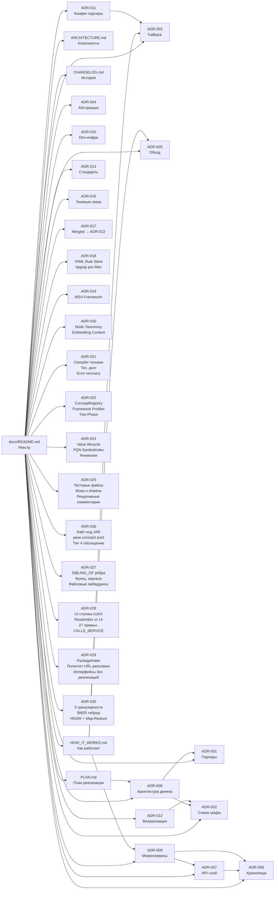

# Реестр документации — Blast Radius Engine

Единая точка входа в документацию проекта. Все документы связаны между собой перекрёстными ссылками.

---

## Карта документов



---

## Документы по категориям

### Быстрый старт для анализа

| Документ | Описание |
|---|---|
| [PROBLEMS.md](PROBLEMS.md) | **Краткий справочник** — 81 проблема + идеи решений + ссылки на ADR. Топ-10 по влиянию на IoU |

### Понять, как всё работает

| Документ | Описание |
|---|---|
| [HOW_IT_WORKS.md](HOW_IT_WORKS.md) | Два главных потока: индексация и blast radius. Sequence-диаграммы, примеры |
| [ARCHITECTURE.md](ARCHITECTURE.md) | Статичная схема компонентов, слоёв, сервисов |

### Планирование и история

| Документ | Описание |
|---|---|
| [DEVPLAN.md](DEVPLAN.md) | **Тактический чеклист** — 45 задач по приоритету (Tier 1–5), ориентиры по дням |
| [PLAN.md](PLAN.md) | Архитектурный план — 4 фазы, структура проекта, зависимости |
| [CHANGELOG.md](CHANGELOG.md) | История изменений по версиям |

### Архитектурные решения (ADR)

| ADR | Статус | Тема |
|---|---|---|
| [ADR-001](adr/ADR-001-parser-strategy.md) | Принято | Стратегия парсинга: tree-sitter + javalang fallback |
| [ADR-002](adr/ADR-002-graph-schema.md) | Принято | Схема графа: типы узлов, рёбер, формат NodeId |
| [ADR-003](adr/ADR-003-fallback-strategy.md) | Принято | Fallback-цепочки для разрешения вызовов + URL-маршруты |
| [ADR-004](adr/ADR-004-node-abstraction-levels.md) | Принято | Уровни абстракции, архитектурные паттерны (MVC, Hexagonal, ...) |
| [ADR-005](adr/ADR-005-traversal-strategy.md) | Принято | BFS-обход графа: направление, глубина, параметры |
| [ADR-006](adr/ADR-006-engine-architecture.md) | Принято | Hexagonal + DDD + async workers: структура движка |
| [ADR-007](adr/ADR-007-api-layer.md) | Принято — **Deferred** | FastAPI, роутеры, Pydantic v2 DTO, CLI (Local Mode: argparse + JSON stdout) |
| [ADR-008](adr/ADR-008-storage-architecture.md) | Принято — **Deferred** | PostgreSQL/pgvector, Redis/arq (Local Mode: NetworkX + pickle) |
| [ADR-009](adr/ADR-009-microservices.md) | Принято — **Deferred** | Микросервисы: engine-api, worker-service, ml-service, ui-service |
| [ADR-010](adr/ADR-010-dev-infrastructure.md) | Принято — **Deferred** | Makefile, Docker, React UI (sigma.js) |
| [ADR-011](adr/ADR-011-config-file-parsers.md) | Принято | Парсеры docker-compose/Helm/sh/.env, ENV_INDEX, RouteIndex — **единая таблица приоритетов источников** |
| [ADR-012](adr/ADR-012-graph-naming-visualization.md) | Принято — **Deferred** | Compact display_name, LOD, интерактивная визуализация |
| [ADR-013](adr/ADR-013-documentation-standards.md) | Принято | Стандарты кода: docstrings, комментарии, README, mermaid |
| [ADR-014](adr/ADR-014-ml-pipeline.md) | Принято (A: Tier 3; B,C: Tier 4) | BGE-M3 эмбеддинги (Tier 3); Ollama Rule Engine (Tier 4 → таблица замен) |
| [ADR-015](adr/ADR-015-shared-library.md) | Принято — **Deferred** | Общая библиотека blast-radius-core (домен + порты) |
| [ADR-016](adr/ADR-016-shadow-connections.md) | Принято | Теневые связи: закомментированный код как shadow-рёбра |
| [ADR-017](adr/ADR-017-framework-profiles.md) | **Merged → ADR-022** | Framework profiles (YAML) + роли эмбеддингов → см. ADR-022 §F и §G |
| [ADR-018](adr/ADR-018-unified-rule-store.md) | Принято (YAML + in-memory) | YAML-правила + in-memory dict; ripgrep pre-filter; PostgreSQL — Deferred |
| [ADR-019](adr/ADR-019-multi-signal-analysis.md) | Принято | Мульти-сигнальный анализ: EnvironmentProfile, fuse_signals, изоляция ошибок, comment metadata |
| [ADR-020](adr/ADR-020-node-taxonomy-embedding-context.md) | Принято | Anchor vs Active узлы, шаблонные паттерны, per-role пороги, контекстные эмбеддинги, 7 классов комментариев |
| [ADR-021](adr/ADR-021-compiler-techniques-debt-recovery.md) | Принято (D.4: Tier 5) | CFG, reaching defs, техдолг, градиент восстановления; LLM repair → Tier 5 |
| [ADR-022](adr/ADR-022-language-agnostic-patterns.md) | Принято | ConceptRegistry, Two-Phase Discovery, embeddings fallback, **Framework Profiles** (поглощает ADR-017) |
| [ADR-023](adr/ADR-023-string-value-lifecycle.md) | Принято | Value Flow Graph, классификатор строк (4 ступени), **FQN SymbolIndex + bi-encoder реранкер** (поглощает ADR-024), аномалии train-ticket |
| [ADR-024](adr/ADR-024-symbol-index-fqn-reranker.md) | **Merged → ADR-023** | FQN SymbolIndex, реранкер, аномалии → см. ADR-023 §C, §H, §I |
| [ADR-025](adr/ADR-025-test-files-mock-shadow-comments.md) | Принято | Тестовые файлы: что исключать и что извлекать (MockMvc URL → RouteIndex hint); отсутствие моков в main; рекурсивные комментарии `// //` с conf-penalty по глубине |
| [ADR-026](adr/ADR-026-bytecode-analysis.md) | Принято (Tier 4) | Анализ .jar байт-кода через jawa (pure Python, без JVM): constant pool → URL, queue names, FQN; в репо только maven-wrapper.jar (не код сервисов); флаг `--bytecode-hints` |
| [ADR-027](adr/ADR-027-service-siblings-semantic-files.md) | Принято | `SIBLING_OF` ребро: зеркальные сервисы (order/order-other, travel/travel2); 3-фазный детектор (rule → structural Jaccard → BGE-M3); `split_condition` из CFG; `FileSimilarityIndex` кросс-сервисные эмбеддинги файлов |
| [ADR-028](adr/ADR-028-ui-static-ajax-routes.md) | Принято | UI статика как источник RouteIndex: 49 URL из Angular-JS файлов, 27 прямых CALLS_SERVICE; 14 backend-internal сервисов не вызываются из UI; legacy jQuery-пути без /api/v1/; nginx → gateway топология |
| [ADR-029](adr/ADR-029-package-index-polyglot-interfaces.md) | Принято | PackageIndex (пакетный префикс → сервис) из скана директорий; коллизия `fdse.microservice.*` (ts-basic + ts-station), disambiguate по субпакету; Python `os.getenv()` URL-резолвинг с compose-env; Spring Data repositories (REPOSITORY без Impl); edu.fudan.common → LIBRARY-тип |
| [ADR-030](adr/ADR-030-multi-granularity-embeddings-bm25-hnsw.md) | Принято (A–C: Tier 3; D: Tier 4; E: Tier 5) | 3 гранулярности эмбеддинга (struct/semantic/full); BM25 гибридный поиск + alpha-детектор; HNSW vs brute-force порог; Map-Reduce сервисных векторов; ColBERT для hot-nodes; метаданные без Ollama |

---

## Быстрый старт (Local Mode — без Docker)

```bash
# Установка зависимостей (без PostgreSQL/Redis)
pip install -r requirements.txt

# Индексировать train-ticket и сохранить граф в pickle-кеш
python -m blast_radius index --repo /path/to/train-ticket

# Расчёт blast radius для конкретного файла
python -m blast_radius analyze \
  --repo /path/to/train-ticket \
  --change ts-order-service/src/main/java/order/service/OrderServiceImpl.java \
  | jq .

# Просмотр узла
python -m blast_radius node ts-order-service::order.OrderServiceImpl
```

> Production Mode (FastAPI + PostgreSQL + Redis + React UI) — **Deferred**: ADR-007–010, ADR-012, ADR-015.

---

## Как добавлять документы

1. Создать файл в `docs/adr/ADR-NNN-название.md` (для решений) или `docs/НазваниеДок.md` (для описаний).
2. Добавить строку в таблицу выше.
3. Добавить узел в mermaid-граф карты документов.
4. Добавить запись в `CHANGELOG.md`.
5. В новом документе добавить строку `**Связанные:** ADR-XXX, ...` в шапку.
