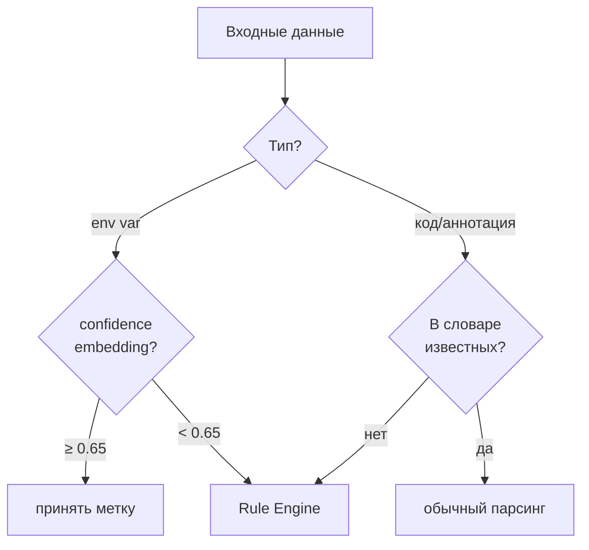
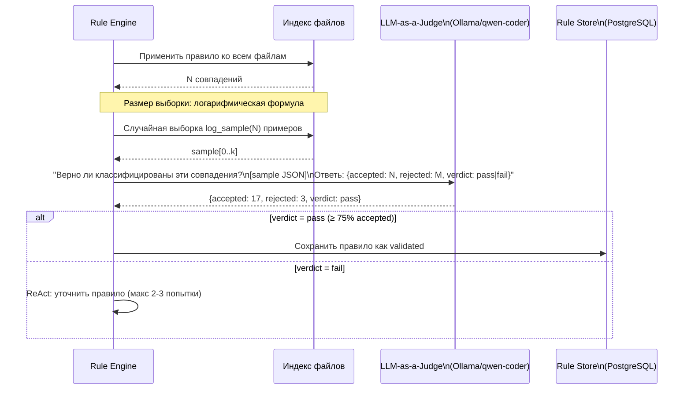
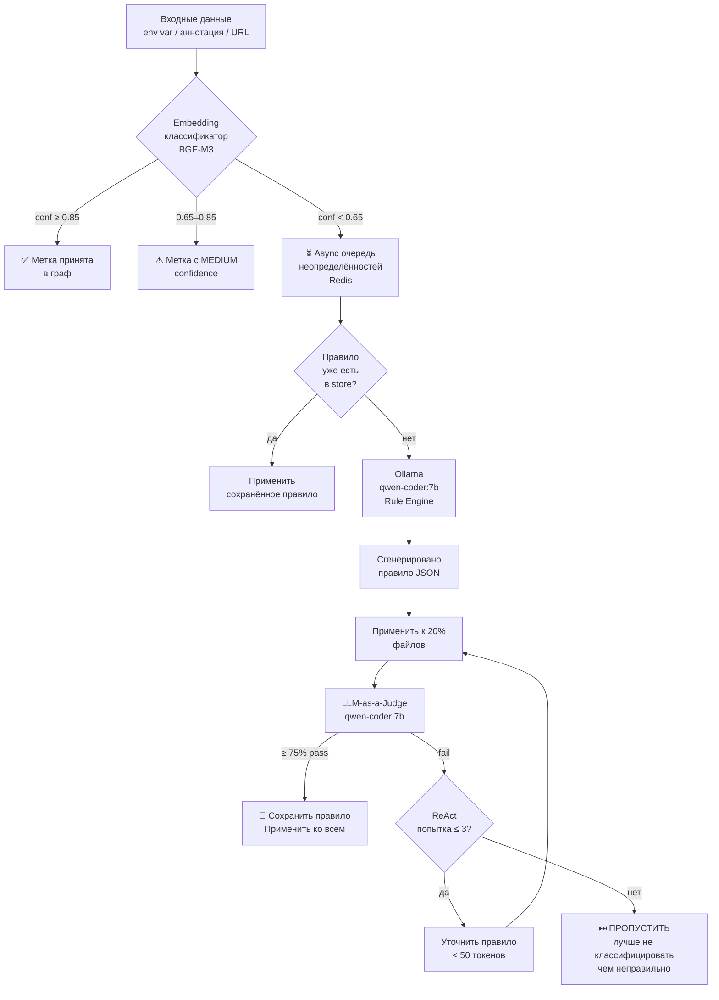

# ADR-014: ML-пайплайн (Embedding-классификатор + Ollama Rule Engine + ReAct Validation)

**Статус:** Принято (компонент A — Tier 3; компоненты B, C — Tier 4)  
**Дата:** 2026-10-13  
**Связанные:** [ADR-003](ADR-003-fallback-strategy.md) (fallback-цепочки), [ADR-022](ADR-022-language-agnostic-patterns.md) (ConceptRegistry)

> **Приоритеты:** Компонент A (Embedding-классификатор) — нужен для Tier 3 (классификация env vars).  
> Компоненты B (Ollama Rule Engine) и C (LLM-as-a-Judge) — **Tier 4**, реализовать только если Component A недостаточен.

---

## Таблица: чем заменить Ollama-вызовы (Tier 1–3)

| Задача | Ollama (Tier 4) | Замена без LLM (Tier 1–3) |
|---|---|---|
| Классификация env vars | Component B → генерирует правило | **Component A**: BGE-M3 cosine с seed-примерами (ADR-014§A) |
| Распознавание HTTP-паттернов | Rule Engine по unknown | **ConceptRegistry** YAML + Framework Profiles (ADR-022) |
| Валидация ts-query правил | LLM-as-a-Judge | `tree_sitter.Language.query(pattern)` — компилируется или нет |
| Распознавание FeignClient/WebClient | Rule Engine | **Framework Profile** `java_spring_boot.yaml` — явный список |
| Классификация RabbitMQ вызовов | Rule Engine | **Regex + аннотации**: `AmqpTemplate` + `@RabbitListener` |
| Сводка (domain_role) узла | Ollama summarization | Вывести из пакета + аннотации + имени класса (детерминировано) |
| Починка сломанного Java-файла | `repair_with_llm()` (ADR-021 D.4) | `javalang` fallback → `MinimalClassNode` (ADR-001) |

---

## Контекст

Два слабых места детерминированного подхода:
1. **Классификация env vars и URL** — regex ненадёжен: `ORDER_SERVICE_URL` очевидно, `BACKEND_ADDR` — уже нет. Нужна семантическая классификация.
2. **Неизвестные идиомы кода** — нестандартные паттерны вызовов, фреймворки, DSL — tree-sitter не знает как их парсить. Нужен механизм обучения правилам на лету.

Ollama используется **по минимуму** — только для двух конкретных задач, не для общего парсинга.

---

## Решение

### Компонент A: Embedding-классификатор (без LLM)

Заменяет regex-классификацию env vars и URL-значений.

#### Принцип: few-shot через cosine similarity

```
Входная переменная:
  name="TS_STATION_SERVICE_URL"
  value="http://ts-station-service:12345/api"

↓ Embedder (BGE-M3 / CodeBERT)

Вектор x ∈ R^768

↓ Cosine similarity с размеченным few-shot банком

Ближайший пример: ("ORDER_SERVICE_URL", "http://ts-order-service", CALLS_SERVICE) → sim=0.94
Второй:          ("REDIS_HOST", "redis://localhost", ignore) → sim=0.41

→ Метка: CALLS_SERVICE, confidence=0.94
```

#### Таксономия меток

| Метка | Пример env var | Пример значения |
|---|---|---|
| `CALLS_SERVICE` | `TS_STATION_SERVICE_URL` | `http://ts-station-service:12345` |
| `SHARES_RESOURCE` | `SPRING_DATASOURCE_URL` | `jdbc:mysql://ts-order-mysql:3306/ts` |
| `SHARES_RESOURCE` | `RABBITMQ_HOST` | `rabbitmq` |
| `ignore` | `SERVER_PORT` | `8080` |
| `ignore` | `SPRING_PROFILES_ACTIVE` | `dev` |
| `unknown` | `BACKEND_ADDR` | `10.0.0.5` | ← передаётся в Ollama

#### Первичный банк паттернов (seed-файлы + ETL)

**Принцип разделения:**
- **Regex** — только для *нахождения и извлечения* переменных из файлов (парсинг). Не для классификации.
- **Seed-паттерны** — текстовые правила первичной классификации очевидных случаев. Записаны в YAML, загружаются в БД при прогреве сервиса через ETL.
- **Embedding-классификатор** — для всего, что seed-паттерны не покрывают.

**Seed-файлы (committed в git):**

```yaml
# src/infrastructure/seeds/env_patterns.yaml

patterns:
  - id: http_service_url
    description: "HTTP URL с hostname, совпадающим с именем другого сервиса"
    value_type: http_url
    hostname_matches_known_service: true
    label: CALLS_SERVICE
    confidence: HIGH

  - id: jdbc_datasource
    description: "JDBC URL для реляционных баз данных"
    value_prefix: ["jdbc:mysql://", "jdbc:postgresql://", "jdbc:h2:"]
    label: SHARES_RESOURCE
    confidence: HIGH

  - id: nosql_url
    description: "URL для MongoDB, Redis как ресурса"
    value_prefix: ["mongodb://", "redis://"]
    label: SHARES_RESOURCE
    confidence: HIGH

  - id: message_broker
    description: "URL брокеров сообщений — разделяемый ресурс"
    value_prefix: ["amqp://", "kafka://"]
    name_contains: ["RABBITMQ", "KAFKA", "BROKER", "QUEUE", "TOPIC"]
    label: SHARES_RESOURCE
    confidence: HIGH

  - id: port_number
    description: "Числовой порт — не создаёт ребро"
    name_suffix: ["_PORT", "_HTTP_PORT", "_GRPC_PORT"]
    value_type: number
    label: ignore
    confidence: HIGH

  - id: feature_flag
    description: "Булевые флаги и профили — не создают ребро"
    name_suffix: ["_ENABLED", "_DISABLED", "_FLAG", "_ACTIVE"]
    value_type: boolean_or_profile
    label: ignore
    confidence: HIGH
```

**ETL при прогреве сервиса:**

```
make db-seed
  → читает src/infrastructure/seeds/env_patterns.yaml
  → для каждого паттерна: матчит примеры из репозитория (regex поиск переменных)
  → генерирует embedding для каждого найденного примера
  → INSERT INTO few_shot_examples (name, value, embedding, label, source='seed')
```

**Порядок применения при классификации:**

```
1. Regex: извлечь все env vars из файла
2. Seed-паттерны: проверить точные условия (HIGH confidence) → если совпало, принять
3. Embedding-классификатор: для оставшихся
4. Async очередь: для confidence < 0.65
```

Хранение: таблица `few_shot_examples` в PostgreSQL (id, name, value, embedding, label, source).  
Пополнение: каждый валидированный Ollama-результат автоматически добавляется в банк.  
Банк растёт между запусками — система становится умнее со временем.

#### Комбинированная классификация env vars

Embedding-вектор строится из **двух сигналов совместно**:

```python
def make_env_var_input(name: str, value: str) -> str:
    """Совмещаем тип значения и суффикс имени для более точного векторного представления."""
    value_type = classify_value_type(value)
    # value_type: "http_url" | "jdbc_url" | "amqp_url" | "hostname" | "port" | "string" | "number"
    name_suffix = extract_name_suffix(name)
    # name_suffix: "_URL" | "_HOST" | "_PORT" | "_ADDR" | "_TOPIC" | "_QUEUE" | ""
    return f"[TYPE:{value_type}] [SUFFIX:{name_suffix}] {name}={value}"
```

Примеры итогового ввода для эмбеддинга:
```
"[TYPE:http_url] [SUFFIX:_URL] TS_STATION_SERVICE_URL=http://ts-station-service:12345"
"[TYPE:jdbc_url] [SUFFIX:_URL] SPRING_DATASOURCE_URL=jdbc:mysql://ts-order-mysql:3306/ts"
"[TYPE:port]     [SUFFIX:_PORT] SERVER_PORT=8080"
"[TYPE:hostname] [SUFFIX:_HOST] RABBITMQ_HOST=rabbitmq"
"[TYPE:hostname] [SUFFIX:_ADDR] BACKEND_ADDR=10.0.0.5"  ← ambiguous → low confidence
```

#### Пороги уверенности и очередь неопределённостей

```
confidence ≥ 0.85  → метка принята, сразу в граф
0.65 ≤ conf < 0.85 → метка принята с пометкой confidence=MEDIUM
conf < 0.65        → помещается в отдельную async очередь неопределённостей
```

**Отдельный поток обработки неопределённостей:**
```
Redis: worker:queue:uncertain  → List<{item, context, confidence}>

Отдельный arq worker (низкий приоритет):
  1. Проверить: появилось ли подходящее правило в store с момента добавления?
     → да: применить правило, убрать из очереди
     → нет: передать в Rule Engine (Ollama)
  2. После обработки: результат → в граф, пример → в few_shot_bank
```

Это не блокирует основной поток анализа: неопределённые элементы обрабатываются асинхронно.

#### Выбор модели эмбеддингов

| Модель | Размер | Плюс | Для задачи |
|---|---|---|---|
| **BGE-M3** | 570MB | Мультиязычный, хорошо на тексте | env vars (имена + значения) ✅ |
| **GraphCodeBERT** | 500MB | Понимает структуру кода | AST-сигнатуры узлов ✅ |
| **CodeBERT** | 500MB | Общий code embedding | fallback, если GraphCodeBERT недоступен |

**Правило:** BGE-M3 — для текстовых классификаций (env vars, конфиги), GraphCodeBERT — для кодовых структур (AST-сигнатуры, group by similarity).

---

### Компонент B: Ollama Rule Engine

Используется только когда embedding-классификатор не уверен (`confidence < 0.65`) или tree-sitter встречает неизвестный паттерн.

#### Триггеры для вызова Ollama



**Неизвестные паттерны кода** — аннотации, не в словаре `ROLE_MAP` (ADR-004), нестандартные HTTP-клиенты, самописные фреймворки.

#### Формат генерируемого правила

Ollama генерирует **структурированный JSON-объект правила**:

```json
{
  "rule_id": "auto_generated_uuid",
  "trigger": "annotation_not_in_dict",
  "pattern_type": "tree_sitter_query",
  "pattern": "(method_declaration (annotation (identifier) @name (#match? @name \"^Feign\")) ) @method",
  "label": "CALLS_SERVICE",
  "edge_type": "CALLS_SERVICE",
  "confidence_hint": "HIGH",
  "description": "FeignClient-подобная аннотация: межсервисный вызов",
  "created_by": "ollama/qwen-coder:7b",
  "created_at": "2026-10-13T..."
}
```

Поддерживаемые `pattern_type`:
- `tree_sitter_query` — для структур в AST (данные для tree-sitter, не код)
- `regex` — для текстовых паттернов (env vars, URLs)

> `python_predicate` исключён: он потребовал бы `eval()` сгенерированного кода.  
> Все правила — это **данные** (строки паттернов), а не исполняемый код.

#### Промпт Ollama (краткий, для скорости)

```
Система: Ты анализатор кода. Отвечай ТОЛЬКО JSON без пояснений.

Задача: По примеру кода создай правило обнаружения паттерна.

Пример кода:
{snippet}

Неизвестный паттерн: {unknown_pattern}

Известные примеры (few-shot):
- "@FeignClient" → CALLS_SERVICE, tree_sitter_query: "(annotation ...)"
- "restTemplate.exchange" → CALLS_SERVICE, regex: "restTemplate\\.exchange"

Верни JSON: {"pattern_type": "...", "pattern": "...", "label": "...", "edge_type": "...", "description": "..."}
```

---

### Компонент C: LLM-as-a-Judge + ReAct Validation

После генерации правила оно проходит автоматическую валидацию.

#### Схема валидации



#### Логарифмическая формула размера выборки

```python
import math

def log_sample_size(n_matches: int, min_k: int = 5, max_k: int = 50) -> int:
    """На малых данных проверяем больше, на больших — меньше (в процентном отношении).

    Примеры: N=5 → k=5, N=20 → k=14, N=100 → k=30, N=1000 → k=50
    """
    if n_matches == 0:
        return 0
    k = int(min_k + (max_k - min_k) * math.log(1 + n_matches) / math.log(1 + 1000))
    return min(k, n_matches)  # не больше чем есть
```

#### ReAct-цикл коррекции

```
Максимум попыток: 2–3
Формат ответа: краткий (< 50 токенов на шаг)

Цикл:
  Observation: "Rule matched 40 entries. Judge: 8/14 accepted (57%) — too broad"
  Thought:     "Pattern захватывает @Component, нужно сузить до @FeignClient"
  Action:      refined_rule = {pattern: "...narrower_pattern_here..."}

  → повторная валидация
  Observation: "Rule matched 12 entries. Judge: 11/12 accepted (92%) — pass"
  → сохранить
```

**Если после 2–3 попыток правило не прошло → ПРОПУСТИТЬ:**
- Элемент НЕ добавляется в граф (лучше пропустить, чем неправильно классифицировать)
- Правило сохраняется как `status=failed` для информации
- Контекст записывается в лог для будущего анализа
- Основной анализ не блокируется

#### Критическая проверка: синтаксис tree-sitter query ПЕРЕД сохранением

Ollama может сгенерировать синтаксически невалидный tree-sitter query. Если такое правило сохранить и применить — оно создаст ложные срабатывания или упадёт с исключением на 635 Java файлах.

**Обязательная валидация перед `SAVE`:**

```python
import tree_sitter as ts

def validate_ts_query(pattern: str, language: ts.Language) -> tuple[bool, str]:
    """Проверить синтаксис tree-sitter query ДО сохранения в БД.
    
    Возвращает (valid: bool, error_msg: str).
    """
    try:
        language.query(pattern)
        return True, ""
    except Exception as e:
        return False, str(e)


def save_rule_validated(rule: GeneratedRule, ts_lang: ts.Language) -> bool:
    """Сохранить правило только если синтаксис корректен."""
    if rule.pattern_type == "tree_sitter_query":
        valid, err = validate_ts_query(rule.pattern, ts_lang)
        if not valid:
            # Передаём ошибку в ReAct для коррекции
            rule.react_feedback = f"Invalid tree-sitter query syntax: {err}"
            return False  # → триггерит ещё одну попытку ReAct или SKIP
    
    # regex: проверяем компиляцию
    elif rule.pattern_type == "regex":
        try:
            re.compile(rule.pattern)
        except re.error as e:
            rule.react_feedback = f"Invalid regex: {e}"
            return False
    
    db.save_rule(rule)
    return True
```

Это **единственная техническая гарантия** качества авто-правил. Без неё одно плохое правило Ollama может засорить весь граф на 635 файлов.

#### Промпт судьи (ультракраткий)

```
Система: Отвечай ТОЛЬКО JSON: {"accepted": N, "rejected": M, "verdict": "pass|fail", "reason": "одна фраза"}

Правило: {rule.description}
Ожидаемая метка: {rule.label}

Совпадения (20 штук):
{sample_as_json}

Правило верное если ≥ 75% совпадений действительно {rule.label}.
```

---

### Хранение правил

```sql
CREATE TABLE generated_rules (
    id          UUID PRIMARY KEY DEFAULT gen_random_uuid(),
    trigger     TEXT NOT NULL,        -- annotation_not_in_dict | low_confidence_env_var | ...
    pattern_type TEXT NOT NULL,       -- tree_sitter_query | regex | python_predicate
    pattern     TEXT NOT NULL,
    label       TEXT NOT NULL,
    edge_type   TEXT NOT NULL,
    status      TEXT NOT NULL,        -- validated | failed | pending
    judge_score FLOAT,                -- доля принятых судьёй
    react_attempts INT DEFAULT 0,
    description TEXT,
    created_by  TEXT,                 -- модель
    created_at  TIMESTAMPTZ DEFAULT now(),
    updated_at  TIMESTAMPTZ DEFAULT now()
);
```

Правила загружаются при старте воркера → кешируются в памяти → применяются как дополнительный шаг после стандартного парсинга.

---

### Модель: Qwen-Coder через Ollama

**Целевая машина:** Apple Silicon / 16GB UMA → обе модели помещаются, скачать обе.

| Модель | RAM (Q4) | Скорость (M-chip) | Рекомендация |
|---|---|---|---|
| `qwen2.5-coder:7b` | ~5GB | ~40 tok/s | **Rule Engine + Judge** (скорость) |
| `qwen2.5-coder:14b` | ~9GB | ~22 tok/s | **Summarization** (качество, офлайн) |
| `deepseek-coder-v2:16b` | ~10GB | ~18 tok/s | Альтернатива если qwen не устраивает |

**Стратегия:** 7b — для интерактивных задач (быстрый ответ нужен), 14b — для батчевого обогащения метаданных (запускается один раз офлайн, скорость не критична).

Использование в трёх точках (не больше):
1. Rule Engine — генерация правила по неизвестному паттерну
2. LLM-as-a-Judge — валидация batch совпадений
3. Summarization — `domain_role` + `summary` для узлов (фаза 3, офлайн)

---

### Итоговая схема ML-пайплайна



---

### Компонент D: Роли эмбеддингов (полная таксономия — ADR-017)

Разные задачи используют разные роли. Каждая роль — отдельная модель/вход/хранение:

| Роль | Модель | Задача |
|---|---|---|
| `ENV_PATTERN` | BGE-M3 | Классификация env var → CALLS_SERVICE / SHARES_RESOURCE |
| `SHADOW_CODE` | BGE-M3 | Код vs текст в комментарии (ADR-016) |
| `CODE_STRUCTURE` | GraphCodeBERT | Семантика узла → group by similarity |
| `UNKNOWN_PATTERN` | BGE-M3 | Кластеризация неизвестных → авто-правила (см. ниже) |
| `SEMANTIC_SEARCH` | BGE-M3 | Семантический поиск для blast radius (фаза 3) |

---

### Компонент E: Auto-Rule Loop — кластеризация неизвестных (ADR-017)

**Ключевой принцип:** Ollama вызывается один раз на **кластер**, не на **каждый** unknown.

```
Unknown-паттерны накапливаются во время парсинга
  ↓
BGE-M3 embed (батч) → DBSCAN кластеризация (eps=0.15 ≈ 85% cosine)
  ↓
Кластер ≥ 3 элементов → выбрать центроид → Ollama один раз
  ↓
Judge валидирует на всём кластере → сохранить правило
  ↓
Следующий раз: похожий паттерн → найти правило по cosine similarity (без Ollama)
```

Жёсткое ограничение: `MAX_OLLAMA_CALLS=25` за сессию. При 3 примерах на кластер — 75+ unknowns без роста числа LLM-вызовов. Подробности — ADR-017.

## Обоснование

- **Embedding вместо regex**: косинусное сходство с примерами устойчивее к вариациям имён переменных, чем паттерны `*_URL`, `*_HOST`.
- **Ollama по минимуму**: LLM — дорогой ресурс (время). Большинство случаев решает embedding-классификатор; Ollama нужен только для genuinely unknown.
- **Правила как артефакты**: сгенерированное и проверенное правило используется повторно без LLM. Чем дольше работает система, тем реже нужна Ollama.
- **Кластеризация unknowns**: один вызов Ollama на кластер вместо одного на паттерн → O(clusters) вместо O(unknowns).
- **ReAct краткий**: промпты ограничены по токенам, ответы — JSON без пояснений. Скорость приоритет.
- **qwen2.5-coder**: лучший open-source вариант для Java/Python анализа в размере 7B.

## Последствия

- **Tier 3 (до замера IoU):** Компонент A (BGE-M3 few-shot) строится из seed-примеров в памяти — без PostgreSQL, без `ml-service`.
- **Tier 4 (после замера IoU, если нужно):** Компоненты B и C с Ollama добавляются поверх, не ломая Tier 3.
- Правила Tier 4 хранятся в YAML-файле (не PostgreSQL — см. ADR-018 обновление). При изменении правила → перезапуск анализа.
- `MAX_OLLAMA_CALLS=25` за сессию — жёсткий лимит; LLM только для кластеров неизвестных (≥3 экземпляров).
- Если правило не прошло ReAct (2–3 попытки) → элемент остаётся `unknown`, не блокирует анализ.
- **Нет `ml-service`** в Local Mode — всё в одном процессе: BGE-M3 через `sentence-transformers`, Ollama через `ollama` Python SDK (если установлен).
